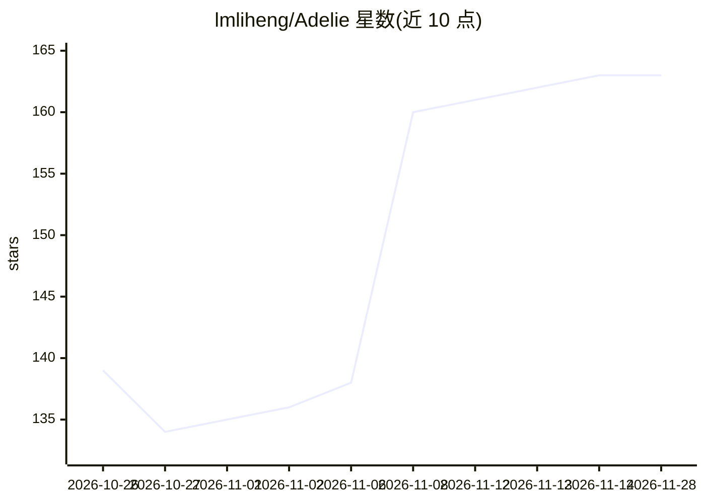

# lmliheng/Adelie

⭐ 163 · TypeScript · Apache-2.0 · 推送 2026-11-27 · [GitHub](https://github.com/lmliheng/Adelie) · [官网](https://lmliheng.github.io/Adelie/docs/) · 个人维护 · 中文 README

**本地优先的多智能体应用开发平台，自动串联创建评测部署**

构建在 PenguinHarness fork 之上的本地优先多智能体应用开发平台，运行于用户自己的电脑或服务器，自动串联 Agent 应用的创建、评测、优化与部署。核心机制包括一句话生成可运行的 Agent 应用（脚手架、代码、运行说明）、Agent 自进化引擎（跑 Benchmark、找失分点、发布 N+1 版并自动快照）、内置四类插件库与插件市场，以及桌面端内置浏览器与实时语音通话。限制：macOS 无官方安装包，Windows 安装包未签名，模型需自配 API Key。

## 筛选速览

| 维度 | 判定 | 备注 |
|---|---|---|
| AI 角色 | `ai-ecosystem` | LLM/agent 周边工具 |
| 许可风险 | `permissive` | Apache-2.0 |
| 部署形态 | `desktop` | 安装包/桌面程序 |
| 模型依赖 | locked-api |  |
| 硬件要求 | — | 无带数字的原话,不猜 |
| 安装摩擦 | `low` | 无编译、无系统依赖或容器化 |
| 成熟度 | — | 结构信号不足 |

## 能力要点

- 一句话描述需求自动生成完整可运行的 Agent 应用
- Agent 自进化引擎：自动跑 Benchmark、找失分点、发布新版本并快照
- 内置办公效率/软件开发/AI 应用开发/Agent 公司四类插件与一键安装的插件市场
- 支持 OpenAI 协议端点，可自定义接入 1000+ 在线与本地模型

## 适用场景

- 一句话生成 RAG 文档问答等 Agent 应用
- 对已有 Agent 应用跑评测并自动迭代优化
- 本地运行多智能体平台并接入自有模型端点
- 通过插件市场安装办公自动化与浏览器操作能力

## 场景标签

`多智能体` `代码生成` `模型评测` `Agent 框架` · 领域:Agent 开发

## 证据(README 行号)

> L5:  本地优先的多智能体应用开发平台，构建在 PenguinHarness 之上
> L34: Adelie 运行在你的电脑或服务器上，自动串联 Agent 应用的创建、评测、优化与部署。三个递进的理由定义了这个平台：
> L97: 上表每个系列只列最新一代，完整预置清单请在应用的**模型**页查看；只要是 OpenAI 协议的端点都可以接入：选择预置，或用自定义端点连接 1000+ 在线与本地模型。

## 星数曲线

2026-10-26 139 → 2026-11-28 163（+24）

---
*卡片 v1 · prompt 1.4 · 生成 2026-11-27 · 置信度 high · 依据 README sha `f95b6a2a0a7e` · [字段定义](../../DATASET.md)*
