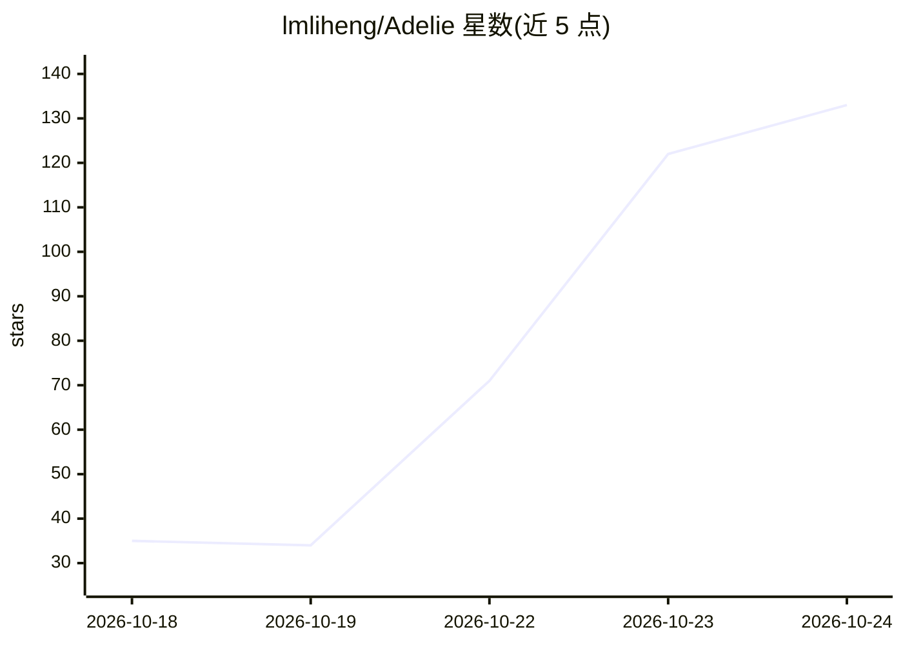

# lmliheng/Adelie

⭐ 133 · TypeScript · Apache-2.0 · 推送 2026-10-23 · [GitHub](https://github.com/lmliheng/Adelie) · 个人维护 · 中文 README

**本地优先的多智能体应用开发平台（PenguinHarness 分支）**

运行在用户自己的电脑或服务器上，串联智能体应用的创建、评测、优化与部署流程，覆盖桌面应用、CLI 与 Web 前端三种形态。通过一句话描述生成完整的智能体应用（脚手架、代码、运行说明），内置四类插件（办公、软件开发、AI 应用开发、Agent Company），插件市场支持一键安装。自述为 PenguinHarness (Apache-2.0) 的 fork，沿用其引擎与界面但使用独立品牌、数据目录、安装渠道与发布流程。支持 OpenAI 协议的托管及本地模型，需至少一个模型 API key 方可运行任务。

## 筛选速览

| 维度 | 判定 | 备注 |
|---|---|---|
| AI 角色 | `ai-ecosystem` | LLM/agent 周边工具 |
| 许可风险 | `permissive` | Apache-2.0 |
| 部署形态 | `desktop` | 安装包/桌面程序 |
| 模型依赖 | locked-api |  |
| 硬件要求 | — | 无带数字的原话,不猜 |
| 安装摩擦 | `low` | 无编译、无系统依赖或容器化 |
| 成熟度 | — | 结构信号不足 |

## 能力要点

- 一句话生成可运行的智能体应用（脚手架+代码+运行说明）
- 内置四类插件与插件市场，智能体可自写并优化 Skills
- 评测中心：创建 Benchmark、按分数迭代优化、快照与可回放 trace
- 支持任意 OpenAI 协议端点，可接入 1000+ 托管与本地模型

## 适用场景

- 在本地或自有服务器上搭建并部署多智能体应用
- 自动生成带引用的 RAG 问答类应用
- 对智能体做基准评测并按分数迭代版本

## 场景标签

`多智能体` `模型评测` · 领域:Agent 开发

## 证据(README 行号)

> L31: Adelie runs on your own computer or server and strings together the creation, evaluation, optimisation
> L45: Describe what you want in one sentence and Adelie builds the whole agent application — scaffold,
> L74: Four kinds of plugin ship in the box (documented under `packages/docs`) — Skills,

## 星数曲线

2026-10-18 35 → 2026-10-24 133（+98）

---
*卡片 v1 · prompt 1.4 · 生成 2026-10-23 · 置信度 mid · 依据 README sha `268e47727f16` · [字段定义](../../DATASET.md)*
