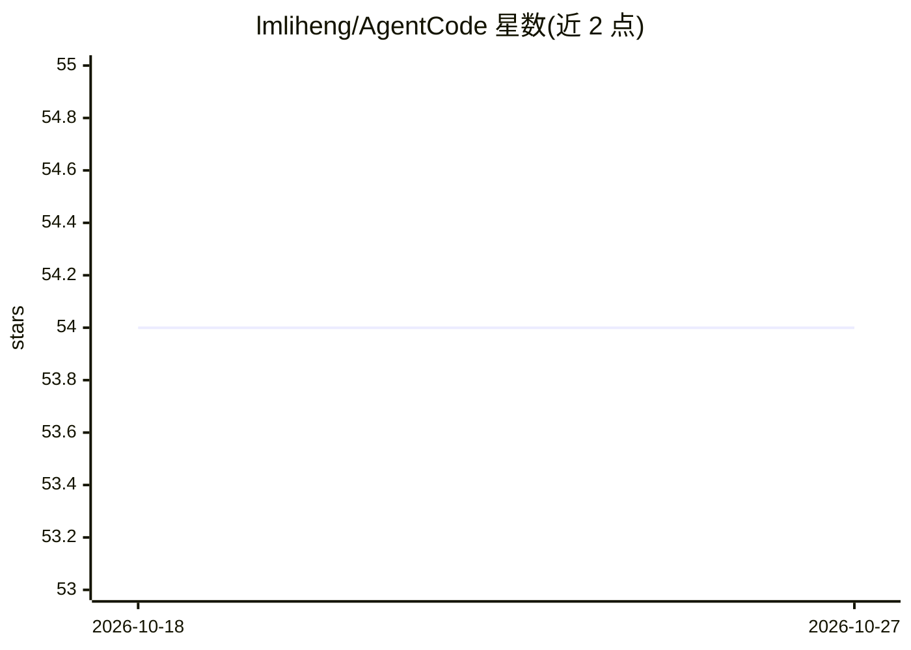

# lmliheng/AgentCode

⭐ 54 · TypeScript · MIT · 推送 2026-10-05 · [GitHub](https://github.com/lmliheng/AgentCode) · [官网](https://deepwiki.com/lmliheng/AgentCode) · 个人维护 · 中文 README

**Agent 应用学习与实战仓库：ReAct 运行时、工具、RAG、MCP 示例**

TypeScript pnpm 多包结构的 Agent 学习与实战仓库：packages/ 下拆分 core / providers / tools / runtime / cli 等可独立安装、发布、测试的包；examples/ 存放学习示例与资料，用 tsx / node 直接运行，不进 workspace。功能覆盖 ReAct 运行时、工具调用与审批预算、RAG 分块检索入库、MCP 主机与示例。需要模型 API Key 的示例与 CLI 从 .env 读取 DEEPSEEK_API_KEY。包配置了 build 与 publishConfig，发布时入口改写为 dist。

## 筛选速览

| 维度 | 判定 | 备注 |
|---|---|---|
| AI 角色 | `ai-ecosystem` | LLM/agent 周边工具 |
| 许可风险 | `permissive` | MIT |
| 部署形态 | `library` | 以包/库形式分发 |
| 模型依赖 | locked-api |  |
| 硬件要求 | — | 无带数字的原话,不猜 |
| 安装摩擦 | `low` | 无编译、无系统依赖或容器化 |
| 成熟度 | — | 结构信号不足 |

## 能力要点

- pnpm 多包结构：core / providers / tools / runtime / cli 可独立安装发布
- ReAct 运行时、工具调用与审批预算、MCP 主机
- RAG 分块检索与入库示例
- 示例与 CLI 从 .env 读取 DEEPSEEK_API_KEY

## 适用场景

- 学习 Agent 应用开发并在本地跑通示例
- 按需独立安装 core / runtime 等包构建自己的 Agent
- 参考 RAG 分块与 MCP 主机实现

## 场景标签

`教程课程` · 领域:学习与行业

## 证据(README 行号)

> L3: 一个 Agent 应用的学习与实战仓库：`packages/` 里是可独立安装 / 发布 / 测试的包，
> L22: 要给 npm 的包（`core` / `providers` / `tools` / `runtime` / `cli`）都配了

## 星数曲线

2026-10-18 54 → 2026-10-27 54（+0）

---
*卡片 v1 · prompt 1.4 · 生成 2026-10-24 · 置信度 low · 依据 README sha `e9adf3c6da37` · [字段定义](../../DATASET.md)*
