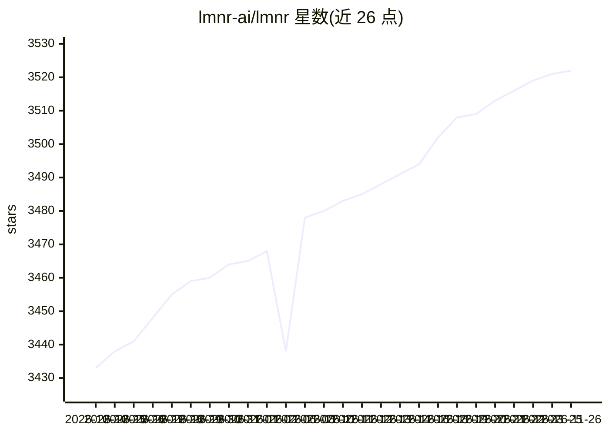

# lmnr-ai/lmnr

⭐ 3,522 · TypeScript · Apache-2.0 · 推送 2026-11-25 · [GitHub](https://github.com/lmnr-ai/lmnr) · [官网](https://laminar.sh) · 组织维护

**面向 AI agent 的开源可观测性平台（追踪/评测/仪表板）**

Laminar 是一个专为 AI agent 构建的开源可观测性平台。核心功能包括：一行代码自动接入 OpenTelemetry 追踪 SDK、用自然语言描述要监测的 agent 行为并在 Slack 提醒、可在本地或 CI/CD 运行评测的 SDK 与 CLI、支持自定义 SQL 的仪表板、数据标注与评测数据集管理。平台用 Rust 编写，提供 20 倍 trace 压缩、实时 trace 查看引擎与全文检索，通过 docker compose 可自托管，也提供托管平台版本。

## 筛选速览

| 维度 | 判定 | 备注 |
|---|---|---|
| AI 角色 | `ai-ecosystem` | LLM/agent 周边工具 |
| 许可风险 | `permissive` | Apache-2.0 |
| 部署形态 | `self-host` | docker 或自建部署 |
| 模型依赖 | — | README 未给出锁定关系 |
| 硬件要求 | — | 无带数字的原话,不猜 |
| 安装摩擦 | `low` | 无编译、无系统依赖或容器化 |
| 成熟度 | — | 结构信号不足 |

## 能力要点

- OpenTelemetry 原生追踪 SDK，一行代码自动接入多种框架与 LLM 提供商
- 自然语言定义 Signals，逐条读取 agent 运行并推送 Slack 提醒
- 可在本地或 CI/CD 运行评测的 SDK 与 CLI，附结果可视化 UI
- Rust 实现，含 20x trace 压缩、实时引擎与全文检索

## 适用场景

- 追踪和调试 agent 应用中每次 LLM 调用与函数执行
- 在 CI/CD 流水线里对 agent 跑评测并比较结果
- 用自然语言设置监控规则，agent 卡循环时收到 Slack 提醒
- 自托管一套私有部署的 LLM 可观测性栈

## 场景标签

`LLM 可观测性` `模型评测` · 领域:评测与运维

## 证据(README 行号)

> L10: Laminar is an open-source observability platform purpose-built for AI agents.
> L18:  - [x] Unopinionated, extensible SDK and CLI for running evals locally or in CI/CD pipeline.
> L46: Laminar is very easy to self-host locally. For a quick start, clone the repo and start the services with docker com

## 星数曲线

2026-10-24 3,433 → 2026-11-26 3,522（+89）

---
*卡片 v1 · prompt 1.4 · 生成 2026-11-23 · 置信度 high · 依据 README sha `03bc09d09fa4` · [字段定义](../../DATASET.md)*
