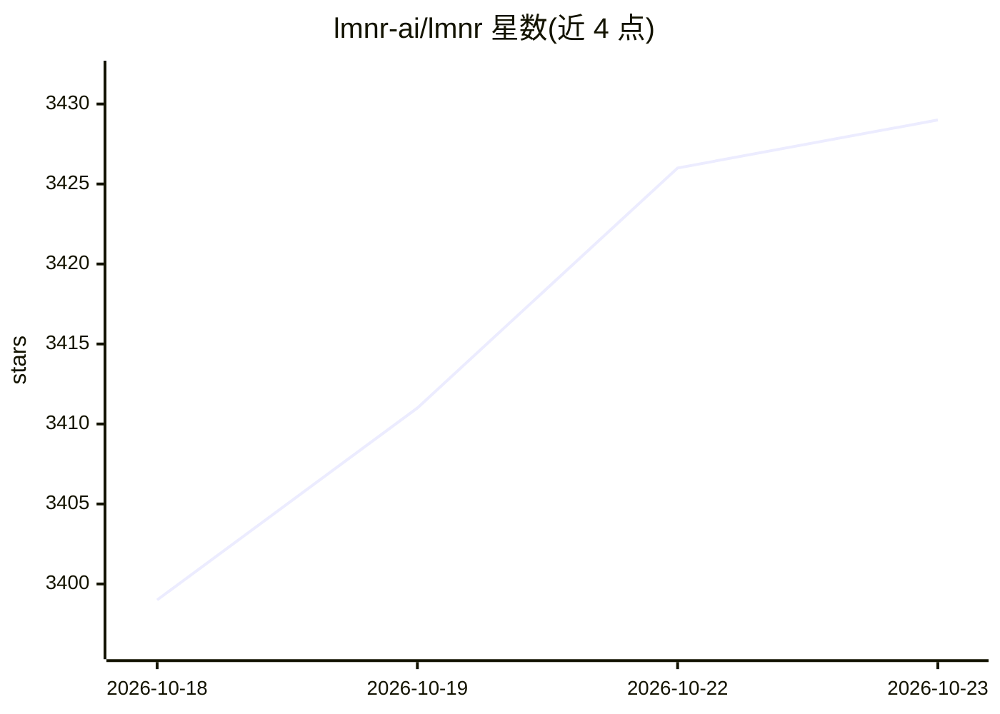

# lmnr-ai/lmnr

⭐ 3,429 · TypeScript · Apache-2.0 · 推送 2026-10-22 · [GitHub](https://github.com/lmnr-ai/lmnr) · [官网](https://laminar.sh) · 组织维护

**面向 AI agent 的开源可观测性平台：追踪、评测、监控告警**

开源的 AI agent 可观测性平台，用 Rust 编写。功能包括：基于 OpenTelemetry 的追踪 SDK（一行代码自动接入 Vercel AI SDK、LangChain、OpenAI、Anthropic、Gemini 等）、用自然语言定义行为监控并在触发时 Slack 通知（Signals）、本地或 CI/CD 运行 evals 的 SDK 与 CLI、SQL 查询 traces/spans/metrics、数据标注与数据集构建、自定义仪表盘，并宣称 20x trace 压缩。支持 docker compose 自托管，也提供托管平台。前端 AI 功能（chat-with-trace、SQL-with-AI）与 AI worker 需在 .env 中配置 LLM provider。自托管部署默认收集匿名遥测，可通过环境变量关闭。提供 TS 与 Python SDK。

## 筛选速览

| 维度 | 判定 | 备注 |
|---|---|---|
| AI 角色 | `ai-ecosystem` | LLM/agent 周边工具 |
| 许可风险 | `permissive` | Apache-2.0 |
| 部署形态 | `self-host` | docker 或自建部署 |
| 模型依赖 | — | README 未给出锁定关系 |
| 硬件要求 | — | 无带数字的原话,不猜 |
| 安装摩擦 | `low` | 无编译、无系统依赖或容器化 |
| 成熟度 | — | 结构信号不足 |

## 能力要点

- OpenTelemetry 原生追踪 SDK，一行代码自动接入多个 LLM 框架
- 自然语言定义行为监控并 Slack 通知
- Rust 实现，20x trace 压缩，traces 上的全文搜索
- docker compose 自托管与 npm/pip SDK

## 适用场景

- 追踪与调试 AI agent 的运行轨迹
- 在 CI/CD 中运行 evals 并可视化对比结果
- 自定义仪表盘监控 agent 指标

## 场景标签

`LLM 可观测性` `模型评测` · 领域:评测与运维

## 证据(README 行号)

> L10: Laminar is an open-source observability platform purpose-built for AI agents.
> L18:  - [x] Unopinionated, extensible SDK and CLI for running evals locally or in CI/CD pipeline.

## 星数曲线

2026-10-18 3,399 → 2026-10-23 3,429（+30）

---
*卡片 v1 · prompt 1.4 · 生成 2026-10-20 · 置信度 high · 依据 README sha `7dbd47ecc132` · [字段定义](../../DATASET.md)*
