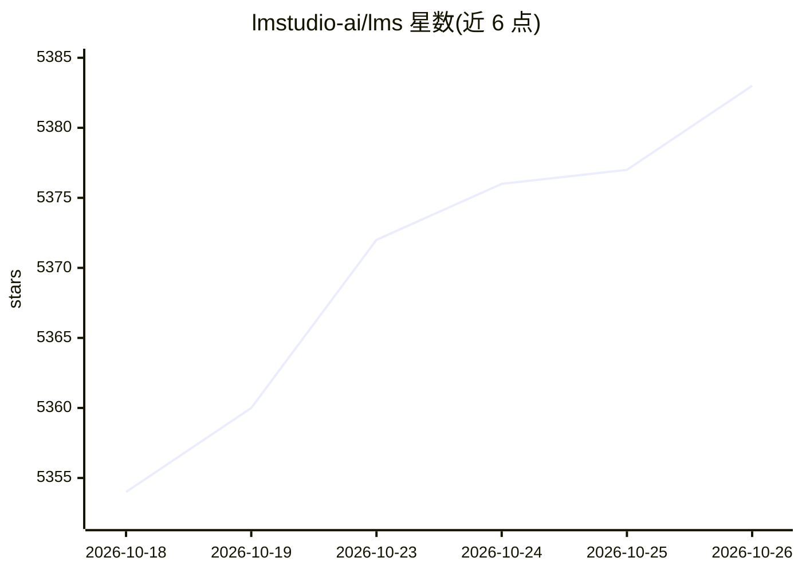

# lmstudio-ai/lms

⭐ 5,383 · TypeScript · MIT · 推送 2026-10-14 · [GitHub](https://github.com/lmstudio-ai/lms) · [官网](https://lms.dev) · 组织维护

**LM Studio 官方命令行工具：管理本地模型与 API 服务器**

基于 lmstudio.js 构建的 CLI，随 LM Studio 0.2.22 及以上版本分发。功能包括启动/停止本地 API 服务器、列出已下载与已加载模型、加载/卸载模型（含 GPU 加速选项）、基于 SDK 创建项目、流式读取日志。支持在 LM Studio、llmster 与 Bionic 三个本地应用间自动选择后端。面向使用 LM Studio 运行本地模型的开发者，可用 npx lmstudio install-cli 引导安装，或从 monorepo 源码构建。

## 筛选速览

| 维度 | 判定 | 备注 |
|---|---|---|
| AI 角色 | `ai-ecosystem` | LLM/agent 周边工具 |
| 许可风险 | `permissive` | MIT |
| 部署形态 | `library` | 以包/库形式分发 |
| 模型依赖 | — | README 未给出锁定关系 |
| 硬件要求 | — | 无带数字的原话,不猜 |
| 安装摩擦 | `low` | 无编译、无系统依赖或容器化 |
| 成熟度 | — | 结构信号不足 |

## 能力要点

- 启动/停止本地 API 服务器与状态查询
- 列出、加载、卸载模型（lms ls/load/unload），支持 JSON 输出与 GPU 加速选项
- lms create 生成基于 LM Studio SDK 的新项目
- 在 LM Studio / llmster / Bionic 之间自动选择本地后端

## 适用场景

- 在脚本或终端中管理本地模型加载与推理
- 启停本地 API 服务器供其他应用调用
- 快速初始化基于 LM Studio SDK 的开发项目

## 场景标签

`推理引擎` · 领域:训练与推理

## 证据(README 行号)

> L3:  <bold><code>lms</code> - Command Line Tool for LM Studio</bold>
> L27: - `lms server start` - To start the local API server.
> L34: - `lms load` - To load a model

## 星数曲线

2026-10-18 5,354 → 2026-10-26 5,383（+29）

---
*卡片 v1 · prompt 1.4 · 生成 2026-10-20 · 置信度 high · 依据 README sha `e070ee7c60ad` · [字段定义](../../DATASET.md)*
