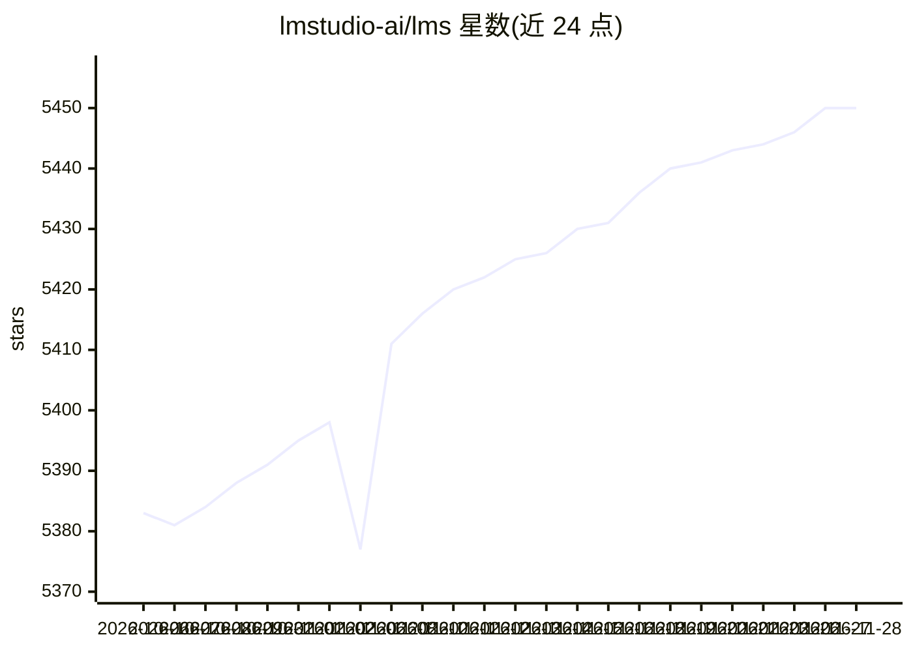

# lmstudio-ai/lms

⭐ 5,450 · TypeScript · MIT · 推送 2026-11-27 · [GitHub](https://github.com/lmstudio-ai/lms) · [官网](https://lms.dev) · 组织维护

**LM Studio 的命令行工具：管理本地模型与 API 服务器**

随 LM Studio 0.2.22 及以上版本附带、基于 lmstudio.js 构建的 CLI。提供子命令查看运行状态、启动/停止本地 API 服务器、列出与加载/卸载已下载模型（支持 JSON 输出）、流式查看日志，以及基于 LM Studio SDK 创建新项目。还可通过 LM Link 将设备开放给其他设备上的 agent 使用，并自动在 LM Studio、llmster、Bionic 之间选择已安装的本地应用。

## 筛选速览

| 维度 | 判定 | 备注 |
|---|---|---|
| AI 角色 | `ai-ecosystem` | LLM/agent 周边工具 |
| 许可风险 | `permissive` | MIT |
| 部署形态 | `library` | 以包/库形式分发 |
| 模型依赖 | — | README 未给出锁定关系 |
| 硬件要求 | — | 无带数字的原话,不猜 |
| 安装摩擦 | `low` | 无编译、无系统依赖或容器化 |
| 成熟度 | — | 结构信号不足 |

## 能力要点

- 启动/停止本地 API 服务器与查看模型加载状态
- 模型加载/卸载管理，支持机器可读 JSON 输出
- 通过 LM Link 开放设备供其他设备上的 agent 调用
- 基于 LM Studio SDK 的项目创建子命令

## 适用场景

- 在脚本或终端中管理本地下载与已加载的 LLM
- 为本地开发启动/停止 LM Studio API 服务器
- 将自己的机器开放给其他设备上的 agent 远程使用

## 场景标签

 · 领域:LLM 基础设施/工具链

## 证据(README 行号)

> L27: - `lms server start` - To start the local API server.
> L32: - `lms ps` - To list all loaded models available for inferencing.
> L34: - `lms load` - To load a model

## 星数曲线

2026-10-26 5,383 → 2026-11-28 5,450（+67）

---
*卡片 v1 · prompt 1.4 · 生成 2026-11-22 · 置信度 high · 依据 README sha `34d395eef19e` · [字段定义](../../DATASET.md)*
