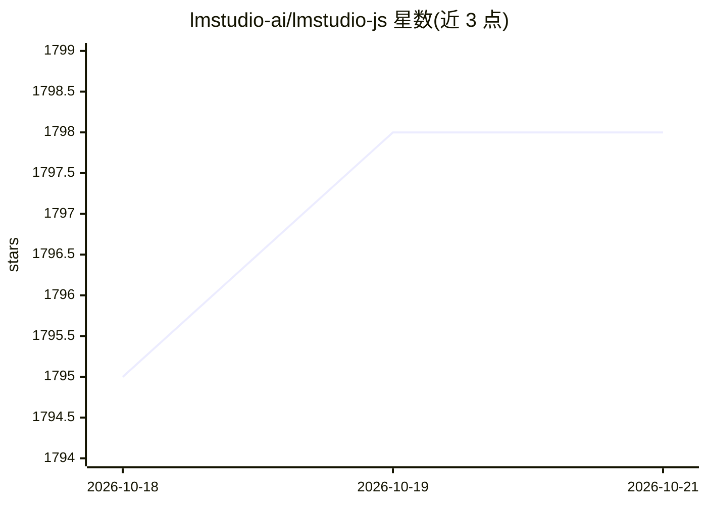

# lmstudio-ai/lmstudio-js

⭐ 1,798 · TypeScript · MIT · 推送 2026-10-21 · [GitHub](https://github.com/lmstudio-ai/lmstudio-js) · [官网](https://www.npmjs.com/package/@lmstudio/sdk) · 组织维护

**LM Studio 官方 TypeScript SDK：在 TS 中调用本地 LLM**

LM Studio 官方维护的 JavaScript/TypeScript 客户端 SDK，通过 LM StudioClient 连接本地 LM Studio 实例，支持聊天与文本补全、定义函数工具构建本地运行的 agent、加载/卸载与配置模型（上下文长度、GPU offload 等）、生成嵌入；兼容浏览器与任意 Node 环境。README 中与 openai SDK 对比，列出本地场景所需能力（模型内存管理、投机解码、模型信息获取等）。通过 npm 安装。

## 筛选速览

| 维度 | 判定 | 备注 |
|---|---|---|
| AI 角色 | `ai-ecosystem` | LLM/agent 周边工具 |
| 许可风险 | `permissive` | MIT |
| 部署形态 | `library` | 以包/库形式分发 |
| 模型依赖 | — | README 未给出锁定关系 |
| 硬件要求 | — | 无带数字的原话,不猜 |
| 安装摩擦 | `low` | 无编译、无系统依赖或容器化 |
| 成熟度 | — | 结构信号不足 |

## 能力要点

- 加载/卸载/配置模型（上下文长度、GPU offload、投机解码）
- 函数工具定义，构建完全本地运行的 agent
- 生成文本嵌入
- 支持浏览器与任意 Node 兼容环境

## 适用场景

- 在 TypeScript 项目中接入本地 LM Studio 模型
- 构建调用本地 LLM 的 agent 应用
- 在代码中管理模型加载与推理参数

## 场景标签

 · 领域:LLM 基础设施/开发工具

## 证据(README 行号)

> L6: `lmstudio-js` is LM Studio's official JavaScript client SDK, written in TypeScript. It allows you to
> L10: - Load, configure, and unload models from memory

## 星数曲线

2026-10-18 1,795 → 2026-10-21 1,798（+3）

---
*卡片 v1 · prompt 1.4 · 生成 2026-10-21 · 置信度 high · 依据 README sha `62fd6a4d59bf` · [字段定义](../../DATASET.md)*
