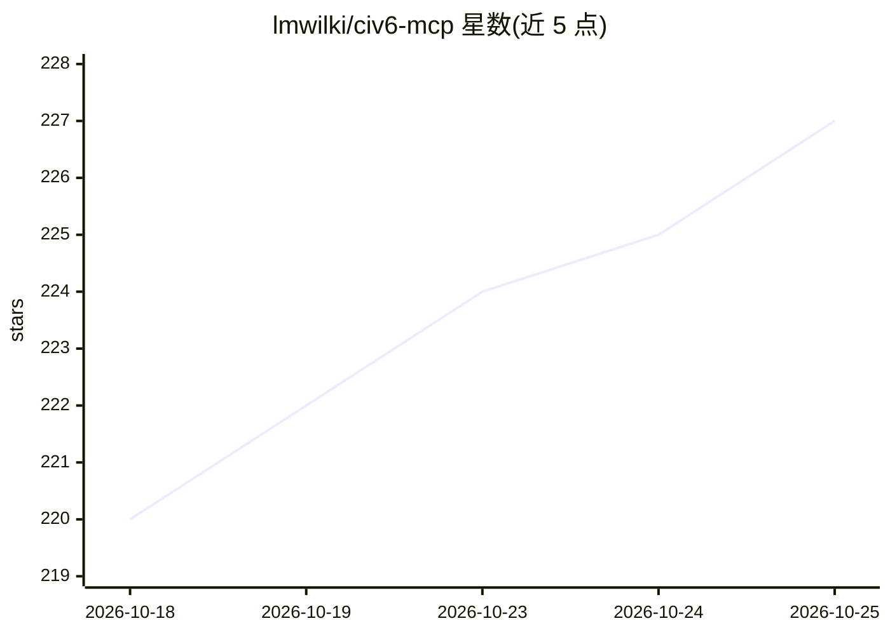

# lmwilki/civ6-mcp

⭐ 227 · Python · MIT · 推送 2026-10-13 · [GitHub](https://github.com/lmwilki/civ6-mcp) · [官网](https://civ6-mcp.lwilko.com) · 个人维护

**让 LLM Agent 完整游玩文明6的 MCP 服务器**

通过文明6的 FireTuner 调试接口建立持久 TCP 连接，向 MCP 客户端（Claude Code、Codex、Gemini CLI 等）暴露 76 个覆盖完整游戏循环的工具：单位操作、城市管理、科研、外交、贸易、宗教、世界大会等。服务器在游戏内两个 Lua VM 中生成并执行 Lua 代码读取状态与下达指令，规则由引擎强制执行，end_turn 时输出前后回合快照。需 Steam 版文明6（含 Gathering Storm DLC）与 Python 3.12+/uv；也定位为长程战略推理评测环境，附带回放 Web 应用。

## 筛选速览

| 维度 | 判定 | 备注 |
|---|---|---|
| AI 角色 | `ai-ecosystem` | LLM/agent 周边工具 |
| 许可风险 | `permissive` | MIT |
| 部署形态 | `desktop` | 安装包/桌面程序 |
| 模型依赖 | — | README 未给出锁定关系 |
| 硬件要求 | — | 无带数字的原话,不猜 |
| 安装摩擦 | `low` | 无编译、无系统依赖或容器化 |
| 成熟度 | — | 结构信号不足 |

## 能力要点

- 76 个工具覆盖文明6完整玩法循环
- 经 FireTuner TCP 协议在游戏 Lua VM 内执行读写，规则由引擎强制
- end_turn 输出前后回合快照与事件报告
- 可作为长程战略推理基准，附带回合回放 Web 应用

## 适用场景

- 让 Claude/Codex/Gemini 等 Agent 代理我打文明6
- 用数百回合的文明6对局评测 LLM 的多回合规划能力
- 回放 Agent 每回合决策过程做分析

## 场景标签

`模型评测` · 领域:评测与运维

## 证据(README 行号)

> L3: An MCP server that lets LLM agents play full games of Civilization VI.
> L5: Connect any MCP-compatible client — Claude Code, Codex, Gemini CLI, or your own — to a running Civ 6 game. The agent
> L186: The server maintains a persistent TCP connection to Civ 6 via the FireTuner debug protocol. It generates Lua code,

## 星数曲线

2026-10-18 220 → 2026-10-25 227（+7）

---
*卡片 v1 · prompt 1.4 · 生成 2026-10-22 · 置信度 high · 依据 README sha `c0a2b5d1fcbe` · [字段定义](../../DATASET.md)*
