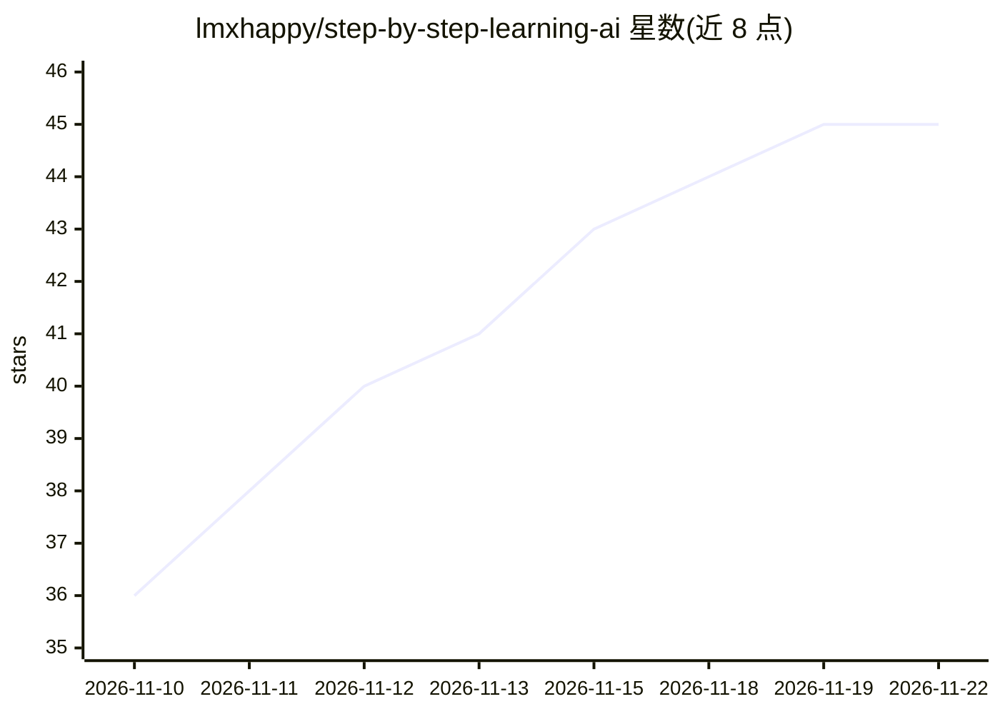

# lmxhappy/step-by-step-learning-ai

⭐ 45 · MIT · 推送 2026-11-20 · [GitHub](https://github.com/lmxhappy/step-by-step-learning-ai) · 个人维护 · 中文 README

**工业搜广推论文精读笔记库：300+ 篇中英双语笔记**

由个人维护的论文笔记仓库（非代码仓库），覆盖推荐、广告、搜索领域的 300+ 篇工业界论文，按行为序列建模、生成式推荐、LLM4Rec、深度检索等 16 个主题组织，自 2024 年 10 月起持续更新。每篇笔记先以中文发表于微信公众号「稳扎稳打学AI」，并附完整英文版（.full.en.md 后缀）。笔记内容涵盖方法做什么、线上 A/B 收益及论证薄弱之处；另有 15 份早期论文清单（仅标题与一句话标签）。仓库不含代码与复现。

## 筛选速览

| 维度 | 判定 | 备注 |
|---|---|---|
| AI 角色 | `ai-knowledge` | 知识聚合/清单类 |
| 许可风险 | `permissive` | MIT |
| 部署形态 | `None` |  |
| 模型依赖 | — | README 未给出锁定关系 |
| 硬件要求 | — | 无带数字的原话,不猜 |
| 安装摩擦 | `low` | 无编译、无系统依赖或容器化 |
| 成熟度 | — | 结构信号不足 |

## 能力要点

- 300+ 篇工业搜广推论文笔记，按 16 个主题文件夹组织
- 每篇中文笔记均带完整英文版（.full.en.md）
- 笔记记录方法、生产 A/B 收益与论证薄弱点
- 另含 15 份早期论文清单（标题+一句话标签）

## 适用场景

- 系统性地按主题阅读推荐/广告/搜索领域论文
- 了解工业界方法在生产 A/B 测试中的实际收益
- 中英双语对照学习论文笔记

## 场景标签

`精选清单` · 领域:学习与行业

## 证据(README 行号)

> L9: **300+ paper notes on industrial recommendation, ads and search, across 16 topics, updated since October 2024.**
> L10: This is a **notes repo, not a code or reproduction repo**. Every note has a full English version.

## 星数曲线

2026-11-10 36 → 2026-11-22 45（+9）

---
*卡片 v1 · prompt 1.4 · 生成 2026-11-18 · 置信度 high · 依据 README sha `2773fe557a4a` · [字段定义](../../DATASET.md)*
