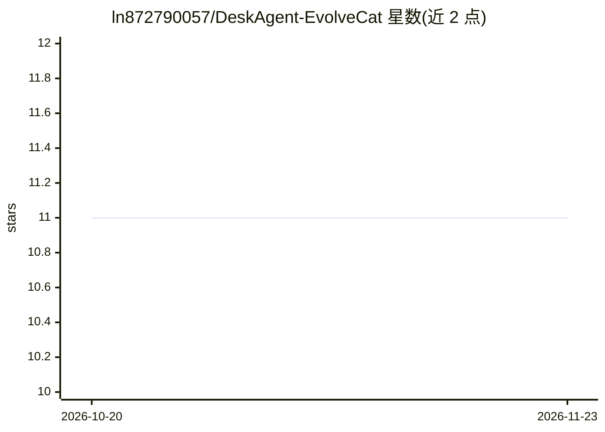

# ln872790057/DeskAgent-EvolveCat

⭐ 11 · Python · 推送 2026-05-19 · [GitHub](https://github.com/ln872790057/DeskAgent-EvolveCat) · 个人维护 · 中文 README

**本地桌面 AI Agent，自动完成调研并输出报告**

基于 Python + PySide6 的通用桌面 Agent 原型，采用四层架构（桌面交互层、Agent Runtime 核心层、工具/Skill 层、记忆层），核心机制为 Planner/Executor/Critic 三层协作与 ReAct 式循环执行。一期验证场景是调研任务：任务理解、查询规划、搜索读取、来源筛选、生成 Markdown 报告并通过 Critic 审核。支持本地 SQLite 记忆沉淀用户偏好与纠错规则，模型通过 OpenAI 兼容协议接入，API Key 由用户自行配置。README 声明项目仍处产品验证阶段，主要验证单机桌面场景。

## 筛选速览

| 维度 | 判定 | 备注 |
|---|---|---|
| AI 角色 | `ai-native` | 本体是模型或模型工具 |
| 许可风险 | `none` | — |
| 部署形态 | `library` | 以包/库形式分发 |
| 模型依赖 | locked-api |  |
| 硬件要求 | — | 无带数字的原话,不猜 |
| 安装摩擦 | `low` | 无编译、无系统依赖或容器化 |
| 成熟度 | `idea` | |

## 能力要点

- Planner/Executor/Critic 三层协作与 ReAct 式循环执行
- 本地 SQLite 记忆沉淀用户偏好、任务结果与纠错规则
- 任务可观察性：状态卡片与任务面板展示执行进度
- 桌面常驻形态：悬浮窗、聊天窗口、系统托盘

## 适用场景

- 输入一个调研目标，自动生成结构化调研报告文件
- 后台发起长任务并在任务面板查看各阶段进度
- 让 Agent 记住我的偏好和纠错规则，后续任务沿用上下文

## 场景标签

`AI 助手` `科研工具` · 领域:对话与助手

## 证据(README 行号)

> L3: 基于 Python + PySide6 构建本地桌面 Agent，系统分为四层架构：桌面交互层、Agent Runtime 核心层、工具 / Skill 层、记忆层。
> L17: DeskAgent 是一个通用桌面 Agent 原型，调研只是首个验证场景，不是产品边界。
> L57: - OpenAI 兼容 Chat Completions 协议

## 星数曲线

2026-10-20 11 → 2026-11-23 11（+0）

---
*卡片 v1 · prompt 1.4 · 生成 2026-11-18 · 置信度 high · 依据 README sha `92bcf9fe7782` · [字段定义](../../DATASET.md)*
