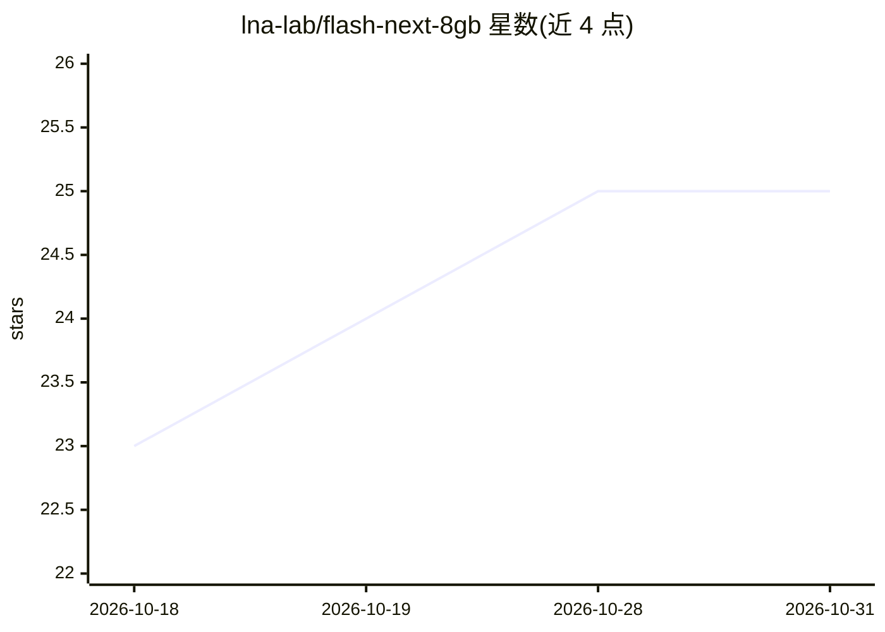

# lna-lab/flash-next-8gb

⭐ 25 · Python · MIT · 推送 2026-09-01 · [GitHub](https://github.com/lna-lab/flash-next-8gb) · 组织维护 · 中文 README

**在 8GB 显存笔记本 GPU 上运行 177B 参数模型的方法与脚本**

提供在 8 GB VRAM + 64 GB RAM 的笔记本上运行 Qwen3.8-Flash-Next（177B 参数 MoE+n-gram 表模型）的完整路径：n-gram 查找表留在磁盘、路由专家（每 token 约 6B 激活）经 ExLlamaV3 的 --moe_cpu_offload 在 CPU 上运行、仅稠密路径驻留 VRAM（实测 6.62 GiB）。附交互式 chat.py、OpenAI 兼容 serve.py（分离 reasoning_content）与 bench.py 基准脚本，并说明 CPU 指令集（AVX-512/AVX2）、磁盘随机读延迟等因素对实际速度的影响，实际笔记本预期约 15 tok/s。面向想在消费级硬件上本地运行大模型的开发者。

## 筛选速览

| 维度 | 判定 | 备注 |
|---|---|---|
| AI 角色 | `ai-ecosystem` | LLM/agent 周边工具 |
| 许可风险 | `permissive` | MIT |
| 部署形态 | `library` | 以包/库形式分发 |
| 模型依赖 | — | README 未给出锁定关系 |
| 硬件要求 | `gpu-8g` | |
| 安装摩擦 | `medium` | 含编译或系统依赖之一 |
| 成熟度 | — | 结构信号不足 |

## 能力要点

- n-gram 表驻留磁盘、专家 CPU 卸载、稠密路径占 VRAM 的分层放置方案
- 提供 chat.py、OpenAI 兼容 serve.py（分离思考/回答内容）与 bench.py
- 实测数据：6.62 GiB VRAM、47.8 GiB RAM、34-35 tok/s（工作站环境）
- 说明量化档位选择（3.05bpw 起步）与 n-gram 表不可降精度的注意事项

## 适用场景

- 在游戏本级别的 8 GB 显存硬件上本地运行 177B 模型
- 通过 OpenAI 兼容 API 让现有客户端接入本地该模型
- 复现或评估该模型在自身硬件上的推理速度

## 场景标签

`推理引擎` · 领域:训练与推理

## 证据(README 行号)

> L11: - **The routed experts (~6 B active per token) go in system RAM**, where ExLlamaV3 will run them on
> L91: An OpenAI-compatible server, so anything that speaks that API can use it:
> L94: python serve.py -m ./Qwen3.8-Flash-Next-exl3-3.05bpw --port 8080

## 星数曲线

2026-10-18 23 → 2026-10-31 25（+2）

---
*卡片 v1 · prompt 1.4 · 生成 2026-10-27 · 置信度 high · 依据 README sha `1dec82d7db38` · [字段定义](../../DATASET.md)*
