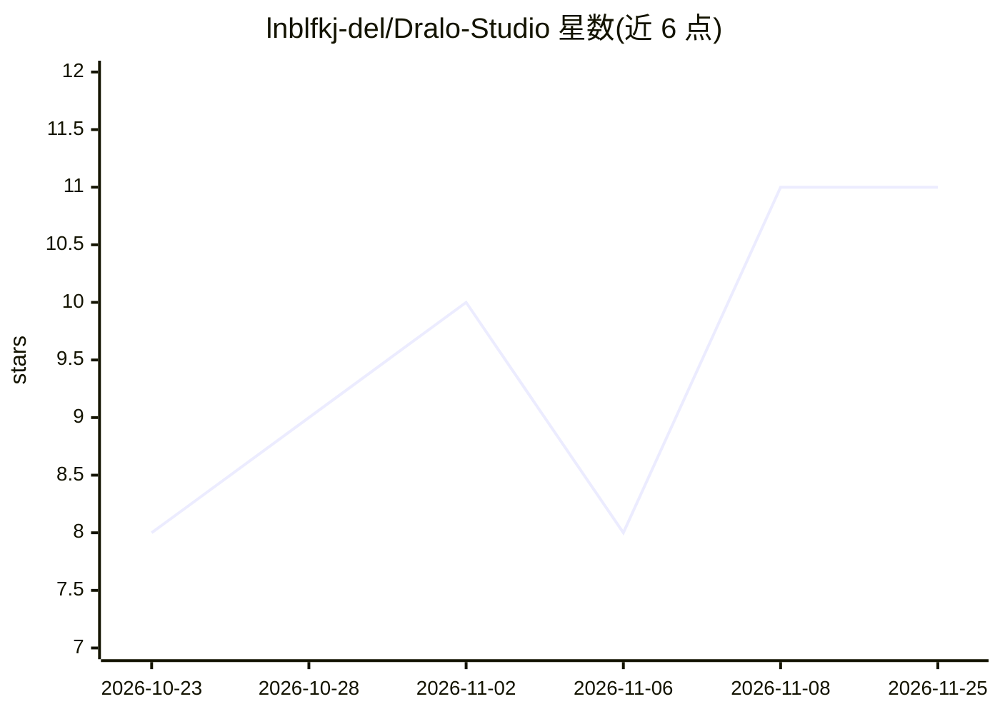

# lnblfkj-del/Dralo-Studio

⭐ 11 · Python · Apache-2.0 · 推送 2026-10-22 · [GitHub](https://github.com/lnblfkj-del/Dralo-Studio) · [官网](https://www.wal365.com) · 个人维护 · 中文 README

**面向短剧创作者的开源 AI 短剧创作工作台**

单机源码发行的开源 AI 短剧创作工作台，将剧本创作、角色与场景管理、分集分镜、无限画布节点工作流、AI 图像/视频生成与多轨剪辑连接为完整流程。前端 React + 本地 FastAPI 服务 + 独立 Worker + SQLite，默认仅监听 127.0.0.1。模型渠道由使用者自行配置（OpenAI 兼容接口、Gemini、Anthropic 等），不附带模型账号或额度；媒体处理需本机 FFmpeg/FFprobe；不提供安装包，需源码启动后经浏览器使用。

## 筛选速览

| 维度 | 判定 | 备注 |
|---|---|---|
| AI 角色 | `ai-native` | 本体是模型或模型工具 |
| 许可风险 | `permissive` | Apache-2.0 |
| 部署形态 | `None` |  |
| 模型依赖 | — | README 未给出锁定关系 |
| 硬件要求 | — | 无带数字的原话,不猜 |
| 安装摩擦 | `medium` | 含编译或系统依赖之一 |
| 成熟度 | `idea` | |

## 能力要点

- 无限画布以节点连线表达提示词、素材与生成关系
- 多模型接入：OpenAI 兼容接口、Google Gemini、Anthropic
- 剧本导入支持 TXT、Markdown、DOCX
- 多轨时间线编辑与 3D 分镜导演台

## 适用场景

- 从剧本到分镜到成片制作短剧或 AI 漫剧
- 在无限画布上组织图像/视频生成工作流
- 自备模型渠道、本地管理素材的独立创作团队协作

## 场景标签

`图像生成` `视频生成` `AI 写作` · 领域:内容生成

## 证据(README 行号)

> L7: Dralo Studio（短剧工坊）是一套**开源 AI 短剧创作工作台**，面向短剧、AI 漫剧与独立影像创作，将**剧本创作、角色与场景、分集分镜、无限画布、AI 图像与视频生成、多轨剪辑**连接为一条完整创作流程。
> L50: 自行配置模型渠道、模型参数、智能体与 Skill，让不同任务使用适合自己的服务。支持的适配包括 OpenAI 兼容接口、Google Gemini 和 Anthropic 等；实际模型能力与接口限制以服务商及当前适配实现为准，不附
> L54: 在资产中心整理素材，在任务中心检查耗时操作的状态与结果。画布基础媒体处理支持裁剪、旋转、截取片段、视频抽帧、提取音轨与音画合成；多轨编辑用于组织画面、声音和字幕，媒体处理需要本机 FFmpeg/FFprobe。

## 星数曲线

2026-10-23 8 → 2026-11-25 11（+3）

---
*卡片 v1 · prompt 1.4 · 生成 2026-11-18 · 置信度 high · 依据 README sha `3529501af474` · [字段定义](../../DATASET.md)*
