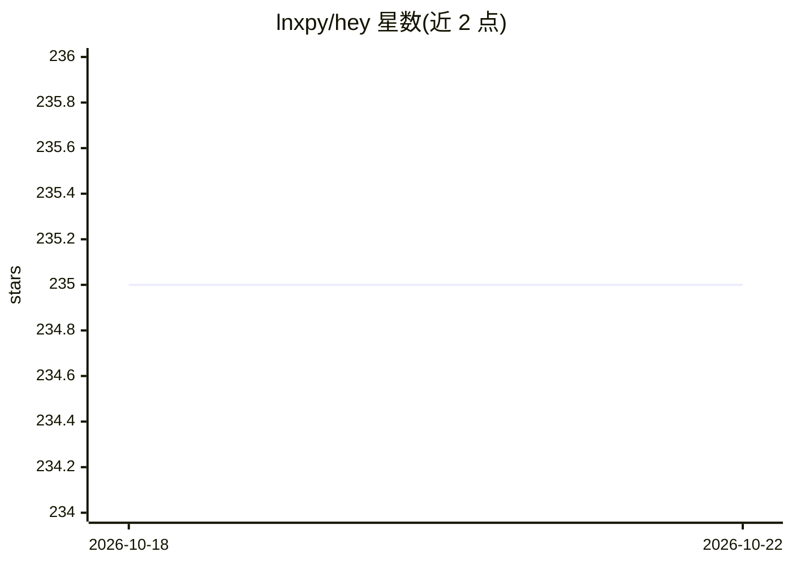

# lnxpy/hey

⭐ 235 · Python · MIT · 推送 2026-10-18 · [GitHub](https://github.com/lnxpy/hey) · [官网](https://pypi.org/project/hey-mindsdb/) · 个人维护

**开发者用 CLI AI 助手：连 LLM 服务做结对问答**

免费 CLI AI 助手，可配置连接任意 LLM 服务，README 推荐使用 mdb.ai 的免费 token。提供 hey ask 快速提问与无子命令时打开编辑器提长问题两种用法，依赖 $EDITOR 环境变量（未设则 Unix 用 vim、Windows 用 notepad）。支持 hey auth 设置 token、hey config create/edit 生成与编辑配置文件。以 pip 包（PyPI 或 git 源码）分发，需 python>=3.8，MIT 许可，为 MindsDB X Hashnode 黑客松作品。

## 筛选速览

| 维度 | 判定 | 备注 |
|---|---|---|
| AI 角色 | `ai-native` | 本体是模型或模型工具 |
| 许可风险 | `permissive` | MIT |
| 部署形态 | `library` | 以包/库形式分发 |
| 模型依赖 | — | README 未给出锁定关系 |
| 硬件要求 | — | 无带数字的原话,不猜 |
| 安装摩擦 | `low` | 无编译、无系统依赖或容器化 |
| 成熟度 | — | 结构信号不足 |

## 能力要点

- CLI 形式连接可配置的 LLM 服务
- ask 快速提问与编辑器长提问两种交互
- auth token 设置与 JSON 配置文件管理

## 适用场景

- 在终端快速向 LLM 提问
- 通过编辑器撰写含代码片段的较长问题
- 切换配置连接不同 LLM 服务

## 场景标签

`AI 助手` · 领域:对话与助手

## 证据(README 行号)

> L9: Hey is a free CLI-based AI assistant that is powered by the LLMs. You can set which LLM service you want to connect 
> L12: > We recommend using the free tokens provided by MindsDB. You can generate one for your personal uses for free on m

## 星数曲线

2026-10-18 235 → 2026-10-22 235（+0）

---
*卡片 v1 · prompt 1.4 · 生成 2026-10-22 · 置信度 high · 依据 README sha `d6c712afbd03` · [字段定义](../../DATASET.md)*
