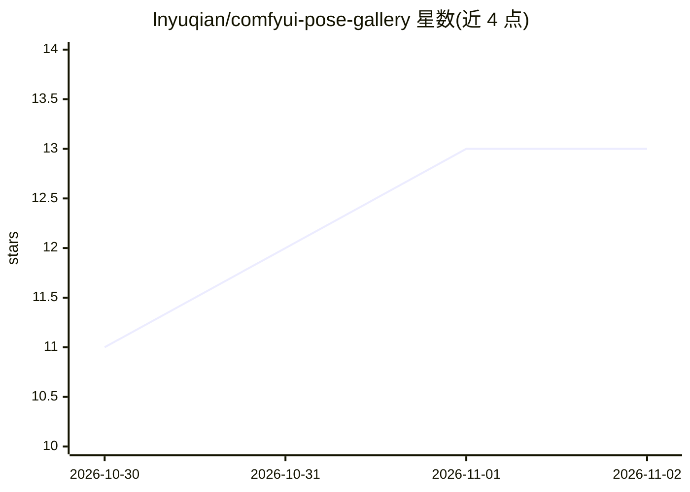

# lnyuqian/comfyui-pose-gallery

⭐ 13 · Python · MIT · 推送 2026-10-29 · [GitHub](https://github.com/lnyuqian/comfyui-pose-gallery) · 个人维护 · 中文 README

**ComfyUI 姿态素材库浏览节点：可视化选线稿并接入生图流程**

一个 ComfyUI 自定义节点包，定位为「姿态库浏览器 + 读取器」：读取本地 JSON 索引描述姿态及其多角度图片，在 ComfyUI 内提供可视化选择面板（按系统/分类/角度筛选、关键词搜索、三档缩略图宽度），把选中线稿读成 IMAGE 张量并输出编号/名称/路径等元信息。提供单张、5 角度组、批量、批次取单张、姿态提示词共 5 个节点；节点上有一键下载素材按钮，也支持 config.json 或环境变量指向自备素材库。仓库本身不含素材，素材著作权归原作者，禁止再分发图像数据。附带基于 Qwen-Image-2.1 的两个实测工作流。

## 筛选速览

| 维度 | 判定 | 备注 |
|---|---|---|
| AI 角色 | `ai-ecosystem` | LLM/agent 周边工具 |
| 许可风险 | `permissive` | MIT |
| 部署形态 | `None` |  |
| 模型依赖 | — | README 未给出锁定关系 |
| 硬件要求 | — | 无带数字的原话,不猜 |
| 安装摩擦 | `low` | 无编译、无系统依赖或容器化 |
| 成熟度 | — | 结构信号不足 |

## 能力要点

- 5 个节点：单张 / 5 角度组 / 批量 / 批次取单张 / 姿态提示词，输出 IMAGE 与元信息严格对齐
- 可视化图库面板：筛选 / 搜索 / 点选，缩略图 3:4 三档宽度，面板可缩放
- 节点内联渲染选中线稿（批量最多显示 4 张）
- 首次使用一键下载素材，或经 config.json / POSE_GALLERY_ROOT 自备素材库

## 适用场景

- 在 ComfyUI 里从本地姿态素材库挑选参考线稿接入生图流程
- 同一姿态多角度、多姿态批量出图并保持提示词同步
- 用姿态描述提示词节点提升线稿还原度

## 场景标签

`图像生成` · 领域:内容生成

## 证据(README 行号)

> L62: 一个 ComfyUI 自定义节点包。本身**不含任何素材**，而是一个「姿态库浏览器 + 读取器」：
> L64: - 读一份本地 JSON 索引（描述有哪些姿态、每个姿态对应哪几张角度的图片）
> L66: - 把选中的图片读成 `IMAGE` 张量，同时输出编号 / 名称 / 路径等元信息

## 星数曲线

2026-10-30 11 → 2026-11-02 13（+2）

---
*卡片 v1 · prompt 1.4 · 生成 2026-10-31 · 置信度 high · 依据 README sha `02df0876ee49` · [字段定义](../../DATASET.md)*
