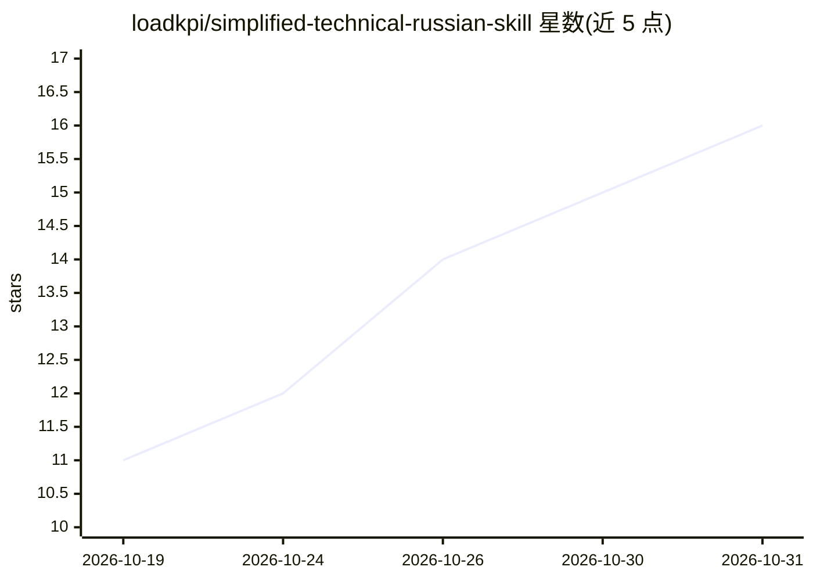

# loadkpi/simplified-technical-russian-skill

⭐ 16 · Python · NOASSERTION · 推送 2026-08-11 · [GitHub](https://github.com/loadkpi/simplified-technical-russian-skill) · 个人维护

**让 AI 编程代理按 ГОСТ Р 58049—2017 写简化俄语技术文本的技能包**

面向 Claude Code、Codex、Cursor 等 AI 编程代理的技能（SKILL.md）包：将俄罗斯国家标准 ГОСТ Р 58049—2017 第 8.2 节的受控技术俄语规则迁移到代码注释、docstring、错误消息、日志、README 与提交说明等场景，含 18 条规则的零依赖 Python 3.7+ 语言学检查器（utr_lint.py），支持 Markdown 与 30+ 语言源码注释提取，可配 CI 与 Claude Code 写文件钩子强制执行。仅适用于俄语文本，不提供 ГОСТ 认证，航空文档需用官方标准。

## 筛选速览

| 维度 | 判定 | 备注 |
|---|---|---|
| AI 角色 | `ai-knowledge` | 知识聚合/清单类 |
| 许可风险 | `none` | NOASSERTION |
| 部署形态 | `None` |  |
| 模型依赖 | — | README 未给出锁定关系 |
| 硬件要求 | — | 无带数字的原话,不猜 |
| 安装摩擦 | `low` | 无编译、无系统依赖或容器化 |
| 成熟度 | — | 结构信号不足 |

## 能力要点

- 以 SKILL.md 规则包形式接入 Claude Code / Codex / Cursor 等代理
- 18 条规则映射标准条款的零依赖 Python 语言学检查器（utr_lint.py）
- 支持 CI 集成与 PostToolUse 钩子在每次写文件后自动检查
- 区分『ГОСТ 规则』与『代码适配』两层，每处偏离均在文档中标注

## 适用场景

- 让 AI 代理把代码注释和文档写成单一含义的简化俄语
- 在 CI 中用语言学检查器拦截违规的俄语技术文本
- 通过钩子强制代理每次写文件后自动修正违规

## 场景标签

 · 领域:AI 代理技能/技术写作规范

## 证据(README 行号)

> L3: Навык заставляет Claude Code, Codex, Cursor и другие ИИ-агенты писать русский
> L39: |`SKILL.md`|Сам навык: правила, режимы работы, приоритеты, формат вывода|
> L46: |`scripts/utr_lint.py`|Линтер на 18 правил. Без зависимостей, Python 3.7 и новее|

## 星数曲线

2026-10-19 11 → 2026-10-31 16（+5）

---
*卡片 v1 · prompt 1.4 · 生成 2026-10-30 · 置信度 high · 依据 README sha `db40d5e1496c` · [字段定义](../../DATASET.md)*
