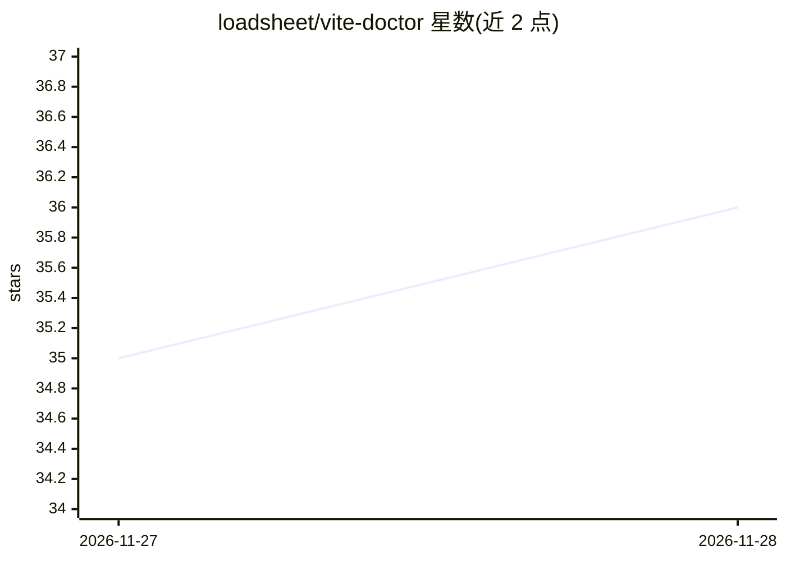

# loadsheet/vite-doctor

⭐ 36 · TypeScript · MIT · 推送 2026-11-27 · [GitHub](https://github.com/loadsheet/vite-doctor) · [官网](https://vite-doctor.onmax.me) · 个人维护

**给前端项目做框架级诊断，拦截 AI agent 产出的框架 bug**

面向 Nuxt、Vue、Nitro、H3、Vite 项目的静态诊断 CLI：读取应用代码、构建配置、项目元数据与 server handlers，在 review 前发现框架 bug；解析已安装的 Nuxt/Nitro/H3 运行时图，按实际加载的框架版本选择诊断规则。支持按 preset/单规则/框架覆盖收窄运行范围、--changed 增量报告、SARIF/JSON 等输出格式，识别 coding-agent 运行时并输出紧凑的 agent 报告（含修复建议与命令模板）；另提供 migrate 子命令在不改写项目的情况下生成迁移分步报告，以及供库作者扩展规则的 extension API。

## 筛选速览

| 维度 | 判定 | 备注 |
|---|---|---|
| AI 角色 | `ai-enhanced` | 去掉 AI 部分产品仍成立 |
| 许可风险 | `permissive` | MIT |
| 部署形态 | `library` | 以包/库形式分发 |
| 模型依赖 | — | README 未给出锁定关系 |
| 硬件要求 | — | 无带数字的原话,不猜 |
| 安装摩擦 | `low` | 无编译、无系统依赖或容器化 |
| 成熟度 | — | 结构信号不足 |

## 能力要点

- 读取源码与配置（非构建产物）的静态框架诊断，按已安装框架版本匹配规则
- 识别 coding-agent 运行时并输出含 remediation 与命令模板的 agent 报告（text/json/sarif 格式）
- --changed/--since 按 git 变更行过滤报告
- migrate 子命令对 Nuxt/Nitro/H3 版本迁移生成分步报告且不改写项目

## 适用场景

- CI 中在构建前运行诊断检查 AI agent 提交的前端代码
- 只对本次改动行运行增量诊断报告
- 评估 Nuxt 5 / Nitro 3 / H3 2 迁移所需的一次性变更

## 场景标签

 · 领域:开发者工具/前端工程化

## 证据(README 行号)

> L1: Vite Doctor: catch framework bugs AI agents miss
> L5:  Catch framework bugs AI agents miss. Diagnostics for Nuxt, Vue, Nitro, H3 and Vite.
> L41: Doctor recognizes coding-agent runtimes through Vercel's agent catalog and returns a compact agent report when outp

## 星数曲线

2026-11-27 35 → 2026-11-28 36（+1）

---
*卡片 v1 · prompt 1.4 · 生成 2026-11-27 · 置信度 high · 依据 README sha `cf90fbf3d8b8` · [字段定义](../../DATASET.md)*
