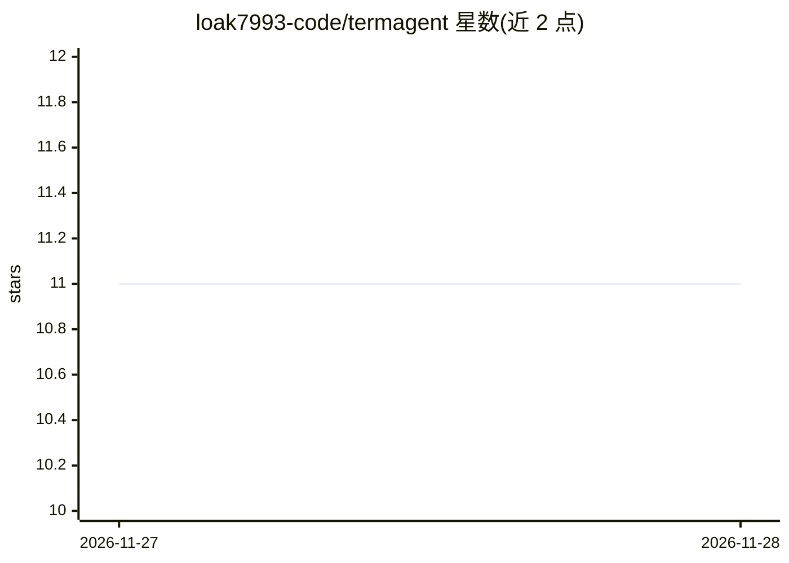

# loak7993-code/termagent

⭐ 11 · Rust · MIT · 推送 2026-11-15 · [GitHub](https://github.com/loak7993-code/termagent) · [官网](https://opencode.ai/zen) · 个人维护

**Termux 安卓终端里的 AI 编码 agent，本地 TUI/Web 运行**

单 Rust 二进制的终端编码 agent，支持原生 TUI 与本地浏览器 UI 两种形态。读取、编辑、搜索文件并经用户审批执行命令，会话以 JSONL 存盘可恢复。供应商与模型元数据来自 models.dev（内置快照，含 309 个供应商、7,958 个支持工具调用的模型），统一走 OpenAI 兼容、Anthropic、Gemini 三种协议。工具调用带风险分级审批，拒绝提权、清洗子进程环境变量。Termux arm64 提供预编译二进制，其他平台从源码构建。

## 筛选速览

| 维度 | 判定 | 备注 |
|---|---|---|
| AI 角色 | `ai-native` | 本体是模型或模型工具 |
| 许可风险 | `permissive` | MIT |
| 部署形态 | `None` |  |
| 模型依赖 | local-ok | 支持本地模型 |
| 硬件要求 | — | 无带数字的原话,不猜 |
| 安装摩擦 | `medium` | 含编译或系统依赖之一 |
| 成熟度 | — | 结构信号不足 |

## 能力要点

- TUI 与本地 Web UI 双形态，Web 模式仅绑定 loopback 并用 token 保护
- 内置 models.dev 快照：309 供应商、7,958 个 tool-capable 模型，可刷新
- 9 个文件/shell 工具，风险分级审批，拒绝 sudo 等提权命令
- reasoning effort 五档控制，按消息内容自动升降档

## 适用场景

- 在安卓手机 Termux 上进行终端编码工作
- 通过本地端点（LM Studio/Ollama）配合本地模型编码
- 需要审批门控与会话留存的命令行 AI 编码助手

## 场景标签

`编码 Agent` · 领域:编码与开发

## 证据(README 行号)

> L3: A coding agent that runs in your terminal and your browser. One Rust binary, one
> L11: It reads files, edits them, searches, runs commands with your approval, and keeps every
> L24: - 309 providers and 7,958 tool-capable models in the bundled snapshot. Refresh from

## 星数曲线

2026-11-27 11 → 2026-11-28 11（+0）

---
*卡片 v1 · prompt 1.4 · 生成 2026-11-27 · 置信度 high · 依据 README sha `0f04dcc0e67a` · [字段定义](../../DATASET.md)*
