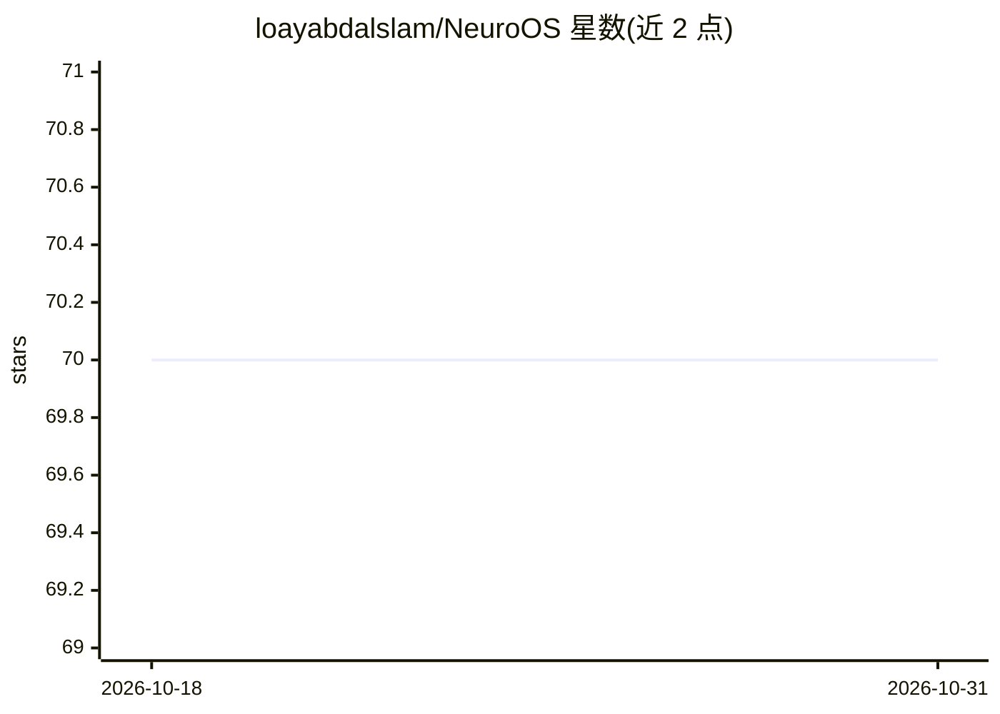

# loayabdalslam/NeuroOS

⭐ 70 · TypeScript · MIT · 推送 2026-06-16 · [GitHub](https://github.com/loayabdalslam/NeuroOS) · 个人维护

**AI 驱动的桌面环境：Electron 桌面系统内置 AI 助手**

基于 Electron 30 + React 19 + TypeScript 构建的桌面环境应用，提供窗口管理、任务栏、开始菜单等桌面系统交互，以及文件管理器（工作区、上传、搜索）、终端模拟器、PIN 认证多用户系统。AI 部分：聊天助手支持 Ollama、OpenAI、Gemini 及 OpenAI 兼容 API，流式输出，可通过工具打开应用、生成文件、浏览工作区；另含 Agent Studio、LLM Manager、MCP Connectors、自动化引擎。通过 git clone 源码与 npm 运行，需配置 .env 的 API key。许可为专有软件（保留所有权利）。

## 筛选速览

| 维度 | 判定 | 备注 |
|---|---|---|
| AI 角色 | `ai-enhanced` | 去掉 AI 部分产品仍成立 |
| 许可风险 | `permissive` | MIT |
| 部署形态 | `None` |  |
| 模型依赖 | local-ok | 支持本地模型 |
| 硬件要求 | — | 无带数字的原话,不猜 |
| 安装摩擦 | `low` | 无编译、无系统依赖或容器化 |
| 成熟度 | — | 结构信号不足 |

## 能力要点

- 窗口/任务栏/开始菜单等桌面环境与多用户 PIN 认证
- AI 助手接入 Ollama/OpenAI/Gemini/OpenAI 兼容 API，流式响应
- AI 工具集成：代开应用、生成保存文件、浏览工作区
- 内置 Agent Studio、LLM Manager、MCP Connectors、自动化引擎

## 适用场景

- 在桌面环境中通过 AI 助手打开应用和管理文件
- 把本机文件夹设为工作区并用 AI 生成保存文件
- 配置多个 LLM 提供商并切换模型使用

## 场景标签

`AI 助手` `GUI 自动化` · 领域:效率与自动化

## 证据(README 行号)

> L5:  An AI-powered desktop operating system built with Electron, React & TypeScript
> L9: **NeuroOS** is a fully-featured desktop environment that runs inside Electron, designed to feel like a real operatin

## 星数曲线

2026-10-18 70 → 2026-10-31 70（+0）

---
*卡片 v1 · prompt 1.4 · 生成 2026-10-24 · 置信度 high · 依据 README sha `d75147f105aa` · [字段定义](../../DATASET.md)*
