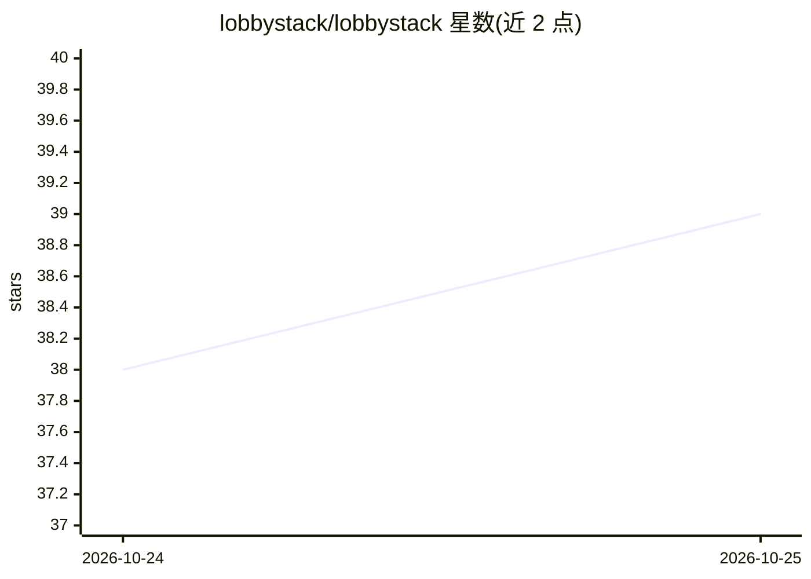

# lobbystack/lobbystack

⭐ 40 · TypeScript · MIT · 推送 2026-10-25 · [GitHub](https://github.com/lobbystack/lobbystack) · [官网](https://lobbystack.com) · 组织维护

**面向小企业的开源 AI 电话前台：接电话、订日程**

面向诊所、美容、汽修、餐饮等本地服务企业的开源 AI 接待平台（MIT，TypeScript monorepo）。功能覆盖：自然语音接听来电（OpenAI GPT-Live over SIP/WebRTC + Twilio 号码）、基于业务知识库的问答、经 Google Calendar 的预约/改期/取消、人工转接、短信收件箱（短信由人工回复）与统一仪表盘。提供托管云服务，也可自托管并自带 Twilio/OpenAI 兼容 API key；本地开发用 pnpm + Docker Compose，默认带 mock provider。当前仅集成 Google Calendar，不连接其他日历或 CRM。

## 筛选速览

| 维度 | 判定 | 备注 |
|---|---|---|
| AI 角色 | `ai-native` | 本体是模型或模型工具 |
| 许可风险 | `permissive` | MIT |
| 部署形态 | `self-host` | docker 或自建部署 |
| 模型依赖 | — | README 未给出锁定关系 |
| 硬件要求 | — | 无带数字的原话,不猜 |
| 安装摩擦 | `low` | 无编译、无系统依赖或容器化 |
| 成熟度 | — | 结构信号不足 |

## 能力要点

- 语音 agent 接听来电并处理打断、实时转接
- 经 Google Calendar 完成预约、改期、取消与提醒短信
- 业务知识库（文档、FAQ、导入网页）支撑回答
- 可自托管并自带 Twilio/OpenAI 兼容等 provider 凭证

## 适用场景

- 无人接听电话时由 AI 前台代接并预约
- 把来电、短信、转写、录音和预约集中在一个仪表盘管理
- 在自己基础设施上自托管并使用自己的 API key

## 场景标签

`语音 Agent` · 领域:对话与助手

## 证据(README 行号)

> L7: LobbyStack is an open-source AI receptionist platform for small businesses. It answers phone calls, books appointmen
> L78: |Voice reception|Inbound phone and browser calls answered by OpenAI GPT-Live, with Twilio phone numbers.|
> L95: |Voice|OpenAI GPT-Live over SIP and WebRTC, Twilio Elastic SIP Trunking|

## 星数曲线

2026-10-24 38 → 2026-10-25 39（+1）

---
*卡片 v1 · prompt 1.4 · 生成 2026-10-25 · 置信度 high · 依据 README sha `e085f60958eb` · [字段定义](../../DATASET.md)*
