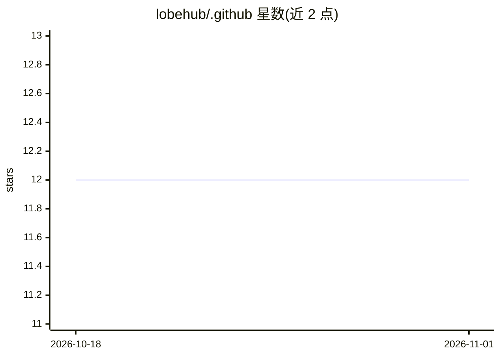

# lobehub/.github

⭐ 12 · TypeScript · 推送 2026-10-22 · [GitHub](https://github.com/lobehub/.github) · 组织维护 · 中文 README

**LobeHub 组织的 GitHub 社区健康文件与组织简介仓库**

存放 @lobehub 组织的社区健康文件（issue/PR 模板等 .github 配置）的仓库，README 兼作组织主页：介绍 LobeHub 主项目（multi-agent 运营平台，声称可雇佣、调度、汇报 AI 团队）、LobeTheme、LobeVidol、LobeI18n 等项目，并列出 LobeUI、LobeIcons、LobeCharts 等 npm 生态包及其版本与下载量。另含贡献指引与赞助渠道，标注两位主要维护者。仓库本身不含可安装产品。

## 筛选速览

| 维度 | 判定 | 备注 |
|---|---|---|
| AI 角色 | `ai-knowledge` | 知识聚合/清单类 |
| 许可风险 | `none` | — |
| 部署形态 | `None` |  |
| 模型依赖 | — | README 未给出锁定关系 |
| 硬件要求 | — | 无带数字的原话,不猜 |
| 安装摩擦 | `low` | 无编译、无系统依赖或容器化 |
| 成熟度 | — | 结构信号不足 |

## 能力要点

- 组织主页展示主项目 LobeHub 与 LobeTheme/LobeVidol/LobeI18n 等项目
- 以表格列出 LobeUI/LobeIcons/LobeCharts 等 npm 包的版本与下载数据
- 包含贡献指引与 OpenCollective 赞助渠道，标注两位主要维护者

## 适用场景

- 了解 LobeHub 组织的项目布局与生态包
- 查找贡献入口与社区规范
- 通过赞助渠道支持组织维护

## 场景标签

 · 领域:AI 应用开发组织/开源社区

## 证据(README 行号)

> L25: ### ⭐️ Our Projects
> L33: ### 📦 Ecosystem

## 星数曲线

2026-10-18 12 → 2026-11-01 12（+0）

---
*卡片 v1 · prompt 1.4 · 生成 2026-11-01 · 置信度 low · 依据 README sha `911d2d608182` · [字段定义](../../DATASET.md)*
