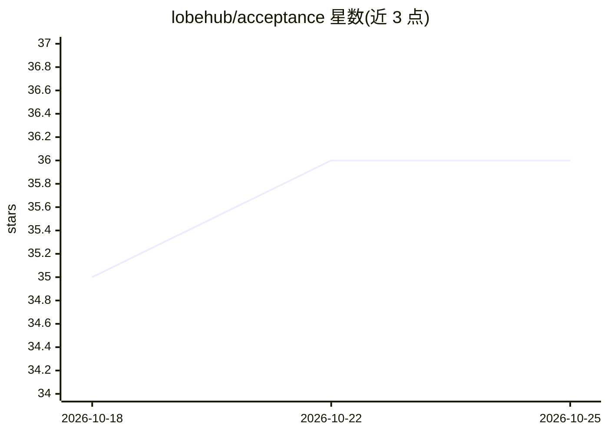

# lobehub/acceptance

⭐ 37 · JavaScript · Apache-2.0 · 推送 2026-10-15 · [GitHub](https://github.com/lobehub/acceptance) · [官网](https://lobehub.com/acceptance) · 组织维护

**面向 Coding Agent 的开源验收测试工具：把需求变成可核验检查**

Acceptance 是一个供编码智能体使用的端到端验收测试技能与 CLI：用户用自然语言描述期望结果，agent 将其转化为可观测的检查项，真实运行产品（Web/CLI/Electron/macOS/iOS 模拟器），发布附带截图、录屏与日志的报告。团队可在同一链接上审阅、按区域标注问题、逐条接受或退回检查项。报告与证据发布到 LobeHub，占用账户存储；需 Node.js 22.15+ 与 LobeHub 账户，报告分享权限的细分设置尚未上线。

## 筛选速览

| 维度 | 判定 | 备注 |
|---|---|---|
| AI 角色 | `ai-ecosystem` | LLM/agent 周边工具 |
| 许可风险 | `permissive` | Apache-2.0 |
| 部署形态 | `desktop` | 安装包/桌面程序 |
| 模型依赖 | — | README 未给出锁定关系 |
| 硬件要求 | — | 无带数字的原话,不猜 |
| 安装摩擦 | `low` | 无编译、无系统依赖或容器化 |
| 成熟度 | — | 结构信号不足 |

## 能力要点

- 把自然语言需求转化为可编辑的可观测检查项
- 覆盖 Web/CLI/Electron/macOS/iOS 模拟器，逐步截图与录屏留证
- 报告支持团队协作审阅、像素区域标注、逐条接受或退回
- 兼容支持 Agent Skills 的多种编码智能体（Claude Code、Codex、Cursor 等）

## 适用场景

- 审阅 agent 在后台或云端沙箱完成的工作，通过报告核验结果
- 检查界面细节问题：暗色模式溢出、小屏幕换行、键盘焦点顺序
- 团队协作验收 agent 交付的功能，逐条退回未通过项

## 场景标签

`模型评测` · 领域:评测与运维

## 证据(README 行号)

> L10: Acceptance is open-source acceptance testing for Agents. Your coding agent turns a request into observable checks, 
> L67: Any coding agent that can load skills and drive the surface you want to check. Use it with **LobeHub, OpenClaw, Cla

## 星数曲线

2026-10-18 35 → 2026-10-25 36（+1）

---
*卡片 v1 · prompt 1.4 · 生成 2026-10-25 · 置信度 high · 依据 README sha `099f6a2db001` · [字段定义](../../DATASET.md)*
