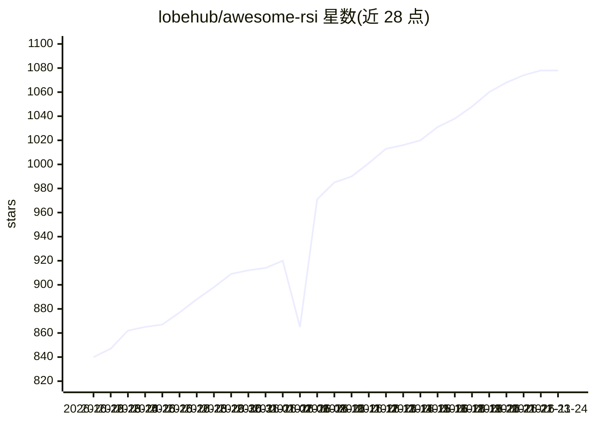

# lobehub/awesome-rsi

⭐ 1,078 · CC0-1.0 · 推送 2026-11-20 · [GitHub](https://github.com/lobehub/awesome-rsi) · 组织维护

**递归自我改进（RSI）研究策展清单：论文与系统地图**

以 awesome-list 形式维护的 RSI 研究地图，收录模型级自我改进、上下文与记忆演化、harness/scaffold 演化、具身自我改进、多智能体、自动化 AI 研究及安全等方向的论文与系统条目。提供术语区分（self-refinement/persistent/recursive）、证据分级（task gain/retained gain/improver gain）等组织框架，面向新入门者与研究者导航文献，声明为社区维护、持续更新的列表，接受贡献与分类建议。

## 筛选速览

| 维度 | 判定 | 备注 |
|---|---|---|
| AI 角色 | `ai-knowledge` | 知识聚合/清单类 |
| 许可风险 | `viral` | CC0-1.0 |
| 部署形态 | `None` |  |
| 模型依赖 | — | README 未给出锁定关系 |
| 硬件要求 | — | 无带数字的原话,不猜 |
| 安装摩擦 | `low` | 无编译、无系统依赖或容器化 |
| 成熟度 | — | 结构信号不足 |

## 能力要点

- 按模型级 RSI、自动化 AI 研究、基准、安全等主题组织的论文条目
- 提供 RSI 术语与证据三级的操作性定义（task/retained/improver gain）
- 声明为社区维护、持续更新的列表并接受贡献

## 适用场景

- 查找自我进化智能体、self-play 微调等方向的代表性论文
- 入门递归自我改进领域的系统性阅读路径
- 了解 RSI 研究的分类框架与安全相关讨论

## 场景标签

`多智能体` `精选清单` `科研工具` `微调` · 领域:Agent 开发

## 证据(README 行号)

> L9: Awesome RSI collects and organizes important work across these areas, including model-level self-improvement, contex
> L15: This is a community-maintained and evolving list. Contributions, missing papers, new benchmarks, frameworks, and su
> L49: Foundational papers, formal treatments, and surveys that establish the vocabulary and core questions of RSI.

## 星数曲线

2026-10-22 840 → 2026-11-24 1,078（+238）

---
*卡片 v1 · prompt 1.4 · 生成 2026-11-24 · 置信度 high · 依据 README sha `ba107efd5674` · [字段定义](../../DATASET.md)*
