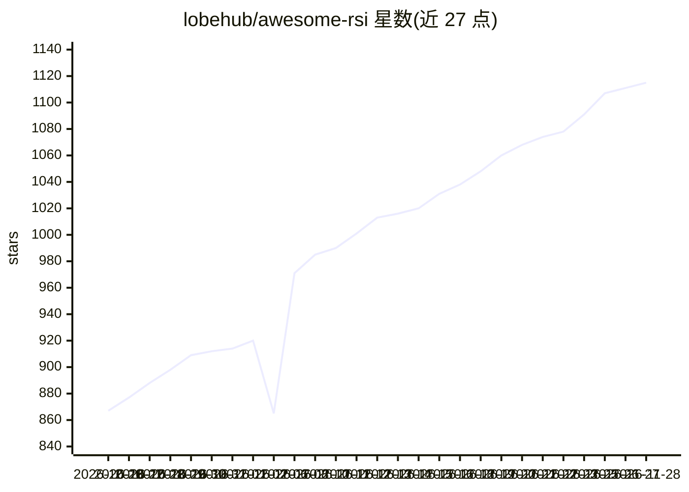

# lobehub/awesome-rsi

⭐ 1,115 · CC0-1.0 · 推送 2026-11-26 · [GitHub](https://github.com/lobehub/awesome-rsi) · 组织维护

**递归自我改进（RSI）研究的策展论文地图**

以 awesome-list 形式组织的递归自我改进研究索引：用术语表区分自精炼、持续自我改进、递归自我改进与 RSI substrate，并提出 task gain / retained gain / improver gain 三级证据标准。内容按类别组织：入门三篇论文、综述与基础文献（1965 年至今）、模型层 RSI（自训练、自奖励、合成数据与自蒸馏）等，每条附一句话摘要与出处（arXiv/会议/年份）。面向追踪该方向的研究者与安全研究者。

## 筛选速览

| 维度 | 判定 | 备注 |
|---|---|---|
| AI 角色 | `ai-knowledge` | 知识聚合/清单类 |
| 许可风险 | `viral` | CC0-1.0 |
| 部署形态 | `None` |  |
| 模型依赖 | — | README 未给出锁定关系 |
| 硬件要求 | — | 无带数字的原话,不猜 |
| 安装摩擦 | `low` | 无编译、无系统依赖或容器化 |
| 成熟度 | — | 结构信号不足 |

## 能力要点

- 按自精炼/持续改进/递归改进/substrate 的术语体系组织条目
- 提出 task gain、retained gain、improver gain 三级证据区分标准
- 覆盖模型级、agent、具身系统、自动 AI 研发、评测与安全等类别
- 每条文献附摘要与出处（arXiv/会议/年份）

## 适用场景

- 快速了解递归自我改进方向的入门文献脉络
- 查找自训练/合成数据等模型级自我改进方法论文
- 调研自我进化 agent 的安全与评测工作

## 场景标签

`精选清单` `科研工具` · 领域:学习与行业

## 证据(README 行号)

> L1: Awesome RSI — A Research Map of Recursive Self-Improvement
> L7: Recursive Self-Improvement (RSI) refers to processes in which AI systems improve their own capabilities and can also
> L57: - A Survey of Self-Evolving Agents: On Path to Artificial Super Intelligence - Surveys what, when, and how foundati

## 星数曲线

2026-10-26 867 → 2026-11-28 1,115（+248）

---
*卡片 v1 · prompt 1.4 · 生成 2026-11-27 · 置信度 high · 依据 README sha `5367331f67e5` · [字段定义](../../DATASET.md)*
