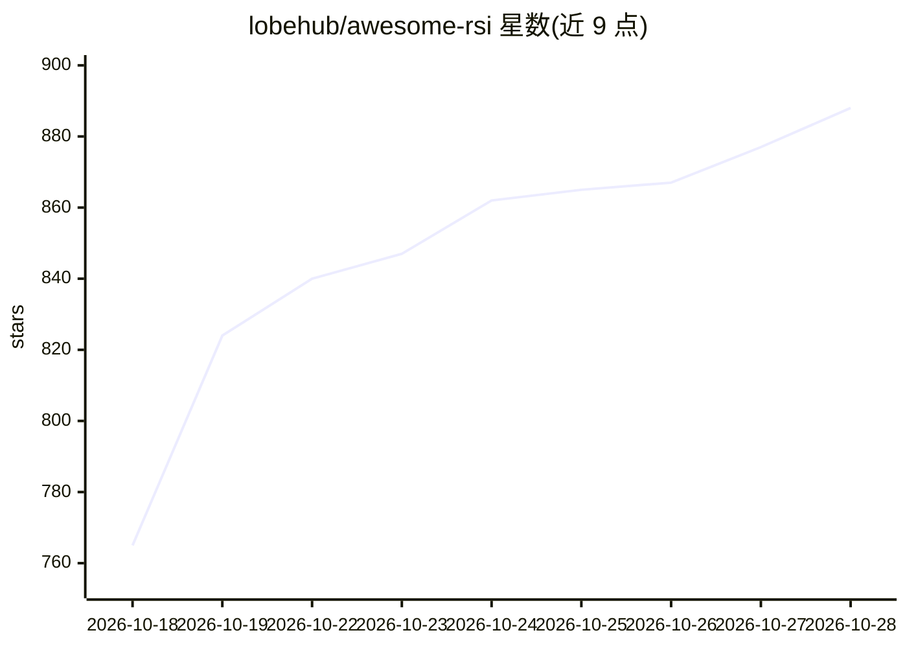

# lobehub/awesome-rsi

⭐ 898 · CC0-1.0 · 推送 2026-10-15 · [GitHub](https://github.com/lobehub/awesome-rsi) · 组织维护

**递归自我改进（RSI）研究文献策展清单**

由社区维护的 Awesome 清单，围绕递归自我改进（RSI）组织研究文献：给出 RSI 相关术语的操作性区分（自我精炼/持久自我改进/递归自我改进/RSI 底座），并提出三级证据标准（任务增益/保留增益/改进器增益）。条目覆盖基础综述、模型级自我训练、合成数据与自蒸馏、自我对弈等，可追溯至 1965 年起的经典文献。面向关注 AI agent 自我进化与 AI 安全的研究者，属演进中的文献地图而非实证结果。

## 筛选速览

| 维度 | 判定 | 备注 |
|---|---|---|
| AI 角色 | `ai-knowledge` | 知识聚合/清单类 |
| 许可风险 | `viral` | CC0-1.0 |
| 部署形态 | `None` |  |
| 模型依赖 | — | README 未给出锁定关系 |
| 硬件要求 | — | 无带数字的原话,不猜 |
| 安装摩擦 | `low` | 无编译、无系统依赖或容器化 |
| 成熟度 | `idea` | |

## 能力要点

- 给出 RSI 术语的操作性区分与三级证据标准（任务/保留/改进器增益）
- 覆盖基础综述、模型级 RSI、合成数据与自蒸馏、自我对弈等类别
- 条目追溯至 1965–2010 年的早期文献（Gödel Machines、元学习等）
- 明确声明分类为组织性而非互斥，部分条目为有界自我改进或使能技术

## 适用场景

- 查找 RSI 与自我进化 agent 领域的综述与经典论文
- 按证据标准区分任务增益与持久自我改进的研究
- 了解自我训练、自蒸馏、自我对弈等子方向的文献脉络

## 场景标签

`精选清单` · 领域:学习与行业

## 证据(README 行号)

> L5: Recursive Self-Improvement (RSI) refers to processes in which AI systems improve their own capabilities and can also
> L9: Awesome RSI collects and organizes important work across these areas, including model-level self-improvement, contex

## 星数曲线

2026-10-18 765 → 2026-10-28 888（+123）

---
*卡片 v1 · prompt 1.4 · 生成 2026-10-21 · 置信度 high · 依据 README sha `aaf6060a07a5` · [字段定义](../../DATASET.md)*
