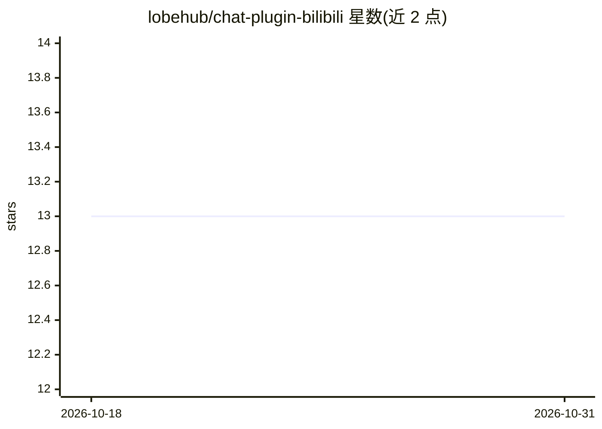

# lobehub/chat-plugin-bilibili

⭐ 13 · TypeScript · MIT · 推送 2026-10-15 · [GitHub](https://github.com/lobehub/chat-plugin-bilibili) · [官网](https://bilibili.chat-plugin.lobehub.com) · 组织维护 · 中文 README

**LobeChat 的 Bilibili 功能调用插件：视频搜索/弹幕/热搜**

面向 LobeChat 的 Function Calling 插件，通过插件设置页安装后，使聊天模型可调用 Bilibili 相关能力：关键词视频搜索、按 AVID/BVID 获取视频重播、获取视频弹幕、热门视频推荐与 Top10 热搜关键词。插件通过 LobeChat 插件网关（Vercel Edge Function 部署）运行，本地开发需使用 bun 克隆仓库并安装运行。由 LobeHub 团队维护，MIT 许可。

## 筛选速览

| 维度 | 判定 | 备注 |
|---|---|---|
| AI 角色 | `ai-ecosystem` | LLM/agent 周边工具 |
| 许可风险 | `permissive` | MIT |
| 部署形态 | `None` |  |
| 模型依赖 | — | README 未给出锁定关系 |
| 硬件要求 | — | 无带数字的原话,不猜 |
| 安装摩擦 | `low` | 无编译、无系统依赖或容器化 |
| 成熟度 | — | 结构信号不足 |

## 能力要点

- 关键词搜索 Bilibili 视频
- 按 AVID/BVID 获取视频重播与弹幕
- 热门视频推荐与 Top10 热搜关键词

## 适用场景

- 在 LobeChat 对话中搜索和查看 Bilibili 视频信息
- 让聊天助手获取 Bilibili 热点趋势与热搜榜
- 结合弹幕数据做内容互动查询

## 场景标签

 · 领域:聊天机器人插件/内容平台接入

## 证据(README 行号)

> L38: This is a function calling plugin for Lobe Chat, you can install it in plugin setting page.
> L48: > Plugins provide a means to extend the [Function Calling][fc-link] capabilities of LobeChat. They can be used to i

## 星数曲线

2026-10-18 13 → 2026-10-31 13（+0）

---
*卡片 v1 · prompt 1.4 · 生成 2026-10-31 · 置信度 high · 依据 README sha `90a745acf3d2` · [字段定义](../../DATASET.md)*
