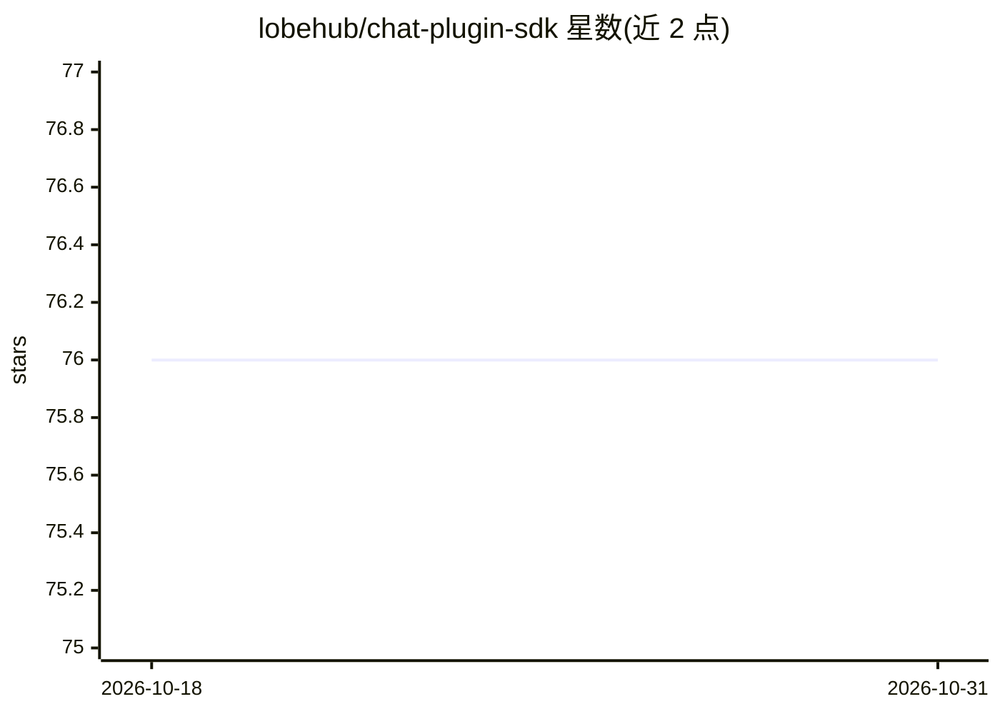

# lobehub/chat-plugin-sdk

⭐ 76 · TypeScript · MIT · 推送 2026-10-23 · [GitHub](https://github.com/lobehub/chat-plugin-sdk) · [官网](https://chat-plugin-sdk.lobehub.com) · 组织维护

**帮助开发者构建 LobeChat Function Calling 插件的 SDK**

LobeHub 维护的 TypeScript SDK，用于创建 LobeChat 的 Function Calling 聊天插件：扩展对话中的函数调用能力，并支持新的消息结果渲染方式。配套生态包括插件索引仓库（lobe-chat-plugins）、插件模板与部署在 Vercel 上的插件网关服务。以 npm 包分发，提供在线 SDK 文档；本地开发需使用 Bun 工具链（git clone 后 bun install/dev）。

## 筛选速览

| 维度 | 判定 | 备注 |
|---|---|---|
| AI 角色 | `ai-ecosystem` | LLM/agent 周边工具 |
| 许可风险 | `permissive` | MIT |
| 部署形态 | `None` |  |
| 模型依赖 | — | README 未给出锁定关系 |
| 硬件要求 | — | 无带数字的原话,不猜 |
| 安装摩擦 | `low` | 无编译、无系统依赖或容器化 |
| 成熟度 | — | 结构信号不足 |

## 能力要点

- 为 LobeChat 插件提供 Function Calling 能力扩展接口
- 支持插件自定义消息结果渲染方式
- 配套插件模板、插件索引与插件网关服务
- 提供在线 SDK 文档

## 适用场景

- 为 LobeChat 开发自定义 Function Calling 插件
- 基于官方插件模板搭建插件项目
- 查阅 LobeChat 插件生态的开发规范

## 场景标签

`Agent 框架` · 领域:Agent 开发

## 证据(README 行号)

> L3: SDK for LobeChat funciton calling plugins
> L28: The LobeChat Plugin SDK assists you in creating exceptional chat plugins for Lobe Chat.

## 星数曲线

2026-10-18 76 → 2026-10-31 76（+0）

---
*卡片 v1 · prompt 1.4 · 生成 2026-10-24 · 置信度 high · 依据 README sha `7de114cf2c4c` · [字段定义](../../DATASET.md)*
