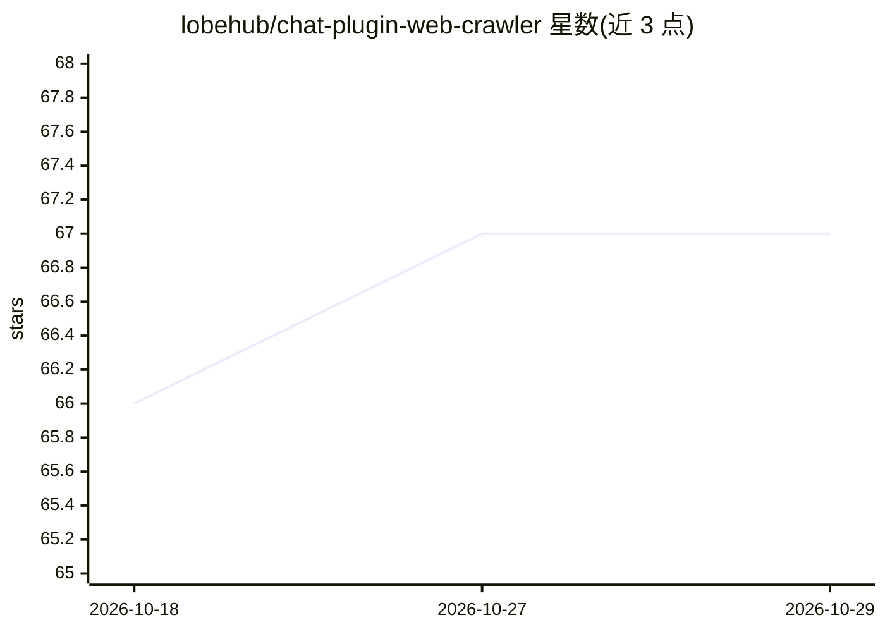

# lobehub/chat-plugin-web-crawler

⭐ 67 · HTML · MIT · 推送 2026-10-15 · [GitHub](https://github.com/lobehub/chat-plugin-web-crawler) · [官网](http://web-crawler.chat-plugin.lobehub.com) · 组织维护 · 中文 README

**LobeChat 网页抓取插件：抓取指定 URL 正文作对话上下文**

LobeChat 的 Function Calling 插件，接收指定 URL，抓取该网页的主要内容并作为上下文输入供对话使用。用户可在 LobeChat 插件设置页一键安装；开发者可通过 GitHub Codespaces 在线开发，或克隆仓库后用 bun install / bun dev 本地运行。同仓库生态提供插件索引、插件模板、chat-plugin-sdk 与部署在 Vercel 上的插件网关服务。

## 筛选速览

| 维度 | 判定 | 备注 |
|---|---|---|
| AI 角色 | `ai-ecosystem` | LLM/agent 周边工具 |
| 许可风险 | `permissive` | MIT |
| 部署形态 | `None` |  |
| 模型依赖 | — | README 未给出锁定关系 |
| 硬件要求 | — | 无带数字的原话,不猜 |
| 安装摩擦 | `low` | 无编译、无系统依赖或容器化 |
| 成熟度 | — | 结构信号不足 |

## 能力要点

- 自动抓取指定 URL 网页主要内容
- 以 Function Calling 插件形式接入 LobeChat
- 支持 GitHub Codespaces 在线开发与 bun 本地开发

## 适用场景

- 在 LobeChat 对话中让 AI 读取网页内容作上下文
- 作为插件开发参考进行二次开发

## 场景标签

`网页抓取` · 领域:效率与自动化

## 证据(README 行号)

> L28: This is a function calling plugin for Lobe Chat, you can install it in plugin setting page.
> L34: Plugins provide a means to extend the Function Calling capabilities of LobeChat. They can be used to introduce new 

## 星数曲线

2026-10-18 66 → 2026-10-29 67（+1）

---
*卡片 v1 · prompt 1.4 · 生成 2026-10-24 · 置信度 high · 依据 README sha `d250eabd5d2d` · [字段定义](../../DATASET.md)*
