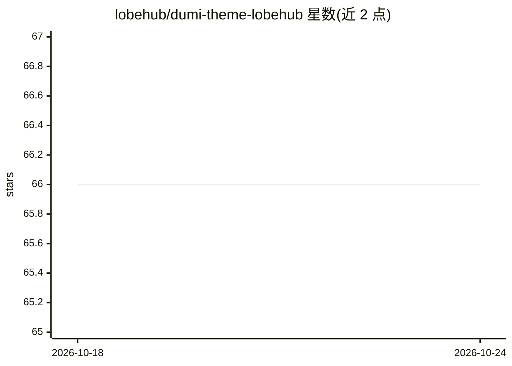

# lobehub/dumi-theme-lobehub

⭐ 66 · TypeScript · MIT · 推送 2026-10-23 · [GitHub](https://github.com/lobehub/dumi-theme-lobehub) · [官网](https://dumi-theme.lobehub.com) · 组织维护 · 中文 README

**面向 Dumi 2 的文档站点主题包，供开发者构建文档站**

基于 @lobehub/ui 与 Ant Design (antd v5) / CSSinJS 实现的 Dumi 2 文档主题包，提供现代风格界面、明暗主题一键切换、基于 Shiki 与 Prism 的语法高亮、可复用组件导出（可在 dumi 本地主题中组合使用）以及移动端适配。安装后随 dumi 启动自动加载，通过 TypeScript 类型文件与示例提供站点配置项。以 npm 包分发，使用 bun 安装；本地开发可经 GitHub Codespaces 或 git clone 后 bun install 运行。

## 筛选速览

| 维度 | 判定 | 备注 |
|---|---|---|
| AI 角色 | `ai-enhanced` | 去掉 AI 部分产品仍成立 |
| 许可风险 | `permissive` | MIT |
| 部署形态 | `None` |  |
| 模型依赖 | — | README 未给出锁定关系 |
| 硬件要求 | — | 无带数字的原话,不猜 |
| 安装摩擦 | `low` | 无编译、无系统依赖或容器化 |
| 成熟度 | — | 结构信号不足 |

## 能力要点

- 基于 @lobehub/ui 与 antd v5 的文档主题，默认提供明暗主题切换算法
- 使用 Shiki 与 Prism 提供语法高亮
- 导出可复用组件供 dumi 本地主题包自由组合
- CSSinJS 方案实现移动端适配

## 适用场景

- 用 Dumi 2 搭建文档站时套用现成主题
- 在本地主题包中复用该主题的组件模块
- 按偏好切换明暗阅读模式

## 场景标签

 · 领域:前端开发/文档工具

## 证据(README 行号)

> L3: dumi-theme-lobehub is a documentation site theme package designed for `Dumi 2`. It provides a more beautiful and use
> L27: - [x] 🤯 **Modern Theme Style:** This theme package adopts modern design techniques such as gradient colors, frosted

## 星数曲线

2026-10-18 66 → 2026-10-24 66（+0）

---
*卡片 v1 · prompt 1.4 · 生成 2026-10-24 · 置信度 mid · 依据 README sha `a6fa7167a518` · [字段定义](../../DATASET.md)*
