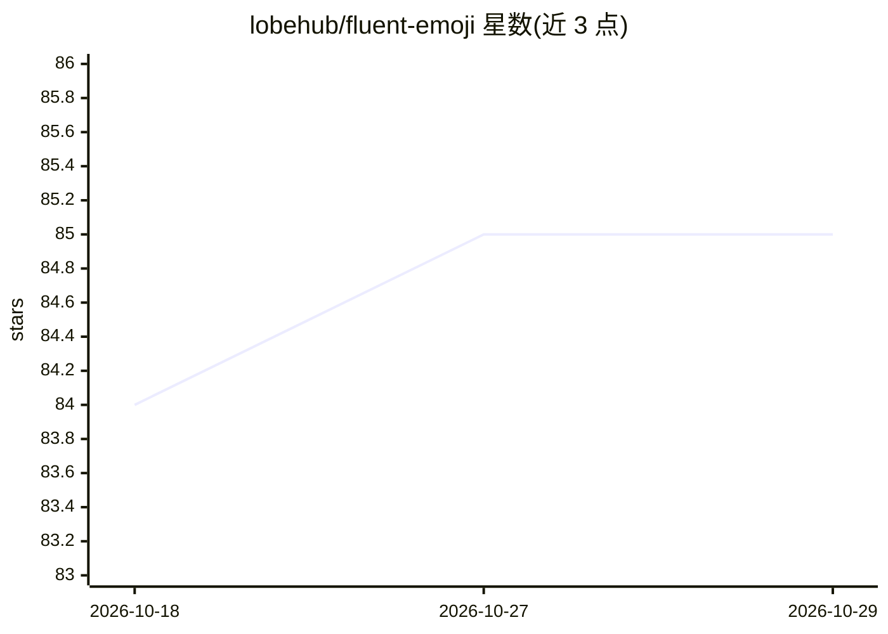

# lobehub/fluent-emoji

⭐ 85 · TypeScript · MIT · 推送 2026-10-25 · [GitHub](https://github.com/lobehub/fluent-emoji) · [官网](https://fluent-emoji.lobehub.com) · 组织维护

**渲染微软 Fluent Emoji 的 React 组件，CDN 按需加载**

LobeHub 维护的 React 组件库：以单一组件渲染 Microsoft Fluent Emoji 的五种风格（animated/3D/modern/flat/mono），图片从 CDN 按需加载以减小打包体积，图片加载失败时回退到本地原生 emoji。支持 React 19 与 Next.js（含 next/image），并提供 getFluentEmojiCDN、字符串中查找 emoji 等辅助函数。包为 ESM only，通过 bun add 安装。另生成 skills.md 与 llms.txt 供 AI 编程助手查阅文档。

## 筛选速览

| 维度 | 判定 | 备注 |
|---|---|---|
| AI 角色 | `ai-enhanced` | 去掉 AI 部分产品仍成立 |
| 许可风险 | `permissive` | MIT |
| 部署形态 | `None` |  |
| 模型依赖 | — | README 未给出锁定关系 |
| 硬件要求 | — | 无带数字的原话,不猜 |
| 安装摩擦 | `low` | 无编译、无系统依赖或容器化 |
| 成熟度 | — | 结构信号不足 |

## 能力要点

- 单一组件切换五种 emoji 风格（animated/3D/modern/flat/mono）
- 图片从 CDN 按需加载，加载失败回退原生 emoji
- 支持 React 19 与 Next.js（含 next/image 自定义图片组件）
- 提供 skills.md 与 llms.txt 的 agent 友好文档

## 适用场景

- 在 React 应用中跨平台统一显示同一样式的 emoji
- 在不打包图片资源的前提下使用 Fluent Emoji
- 让 AI 编程助手按文档正确调用该组件

## 场景标签

 · 领域:前端/React 组件

## 证据(README 行号)

> L5: A React component and helpers that render Microsoft Fluent Emoji in five styles (animated, 3D, modern, flat and mono
> L29: - **AI-native**: agent-ready [`skills.md`][skills-link] and [`llms.txt`][llms-link] so AI assistants use it correct

## 星数曲线

2026-10-18 84 → 2026-10-29 85（+1）

---
*卡片 v1 · prompt 1.4 · 生成 2026-10-24 · 置信度 high · 依据 README sha `263b77bb7fd4` · [字段定义](../../DATASET.md)*
