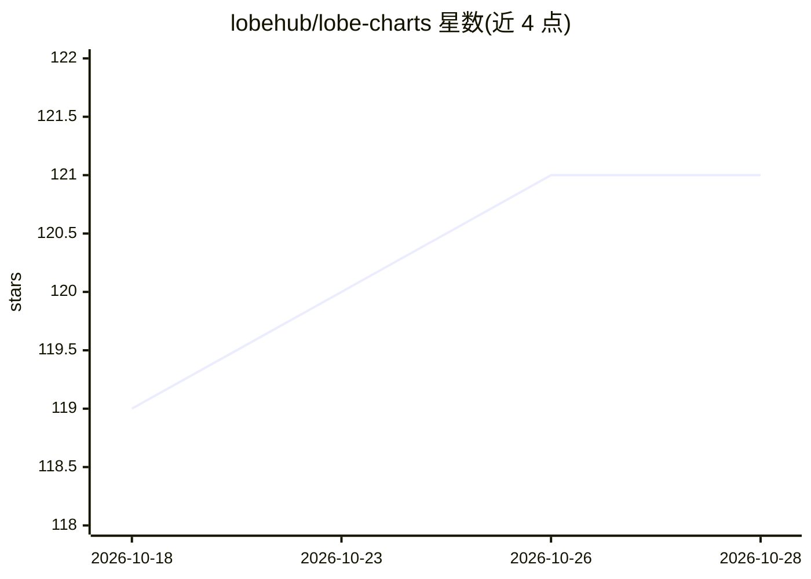

# lobehub/lobe-charts

⭐ 121 · TypeScript · MIT · 推送 2026-10-22 · [GitHub](https://github.com/lobehub/lobe-charts) · [官网](https://charts.lobehub.com) · 组织维护

**面向仪表盘与 AI 榜单的 React 图表组件库，基于 recharts**

LobeHub 团队维护的 React 图表库（@lobehub/charts），基于 recharts 构建，主题适配 Lobe UI。提供业务图表、sparklines、热力图、状态追踪器，以及模型基准与榜单专用图表，组件均为 TypeScript 全类型。数据驱动 API：传入对象数组并选择要绘制的键即可。附带面向编码 agent 的 skills.md 与 llms.txt 文档入口，供 Cursor、Claude Code 等工具读取。仅支持 ESM，需 @lobehub/ui v6 与 react v19 作为 peer 依赖，通过 bun/npm 安装。

## 筛选速览

| 维度 | 判定 | 备注 |
|---|---|---|
| AI 角色 | `ai-enhanced` | 去掉 AI 部分产品仍成立 |
| 许可风险 | `permissive` | MIT |
| 部署形态 | `None` |  |
| 模型依赖 | — | README 未给出锁定关系 |
| 硬件要求 | — | 无带数字的原话,不猜 |
| 安装摩擦 | `low` | 无编译、无系统依赖或容器化 |
| 成熟度 | — | 结构信号不足 |

## 能力要点

- 仪表盘与模型基准/榜单专用图表组件
- 主题适配 Lobe UI，全组件 TypeScript 类型
- 数据驱动 props：传对象数组并选键即可绘制
- 发布 skills.md 与 llms.txt 供编码 agent 读取

## 适用场景

- 为 AI 产品仪表盘构建主题一致的图表
- 展示模型评测基准与榜单数据
- 让 Cursor/Claude Code 等编码 agent 直接学习该库文档并写代码

## 场景标签

 · 领域:前端/数据可视化

## 证据(README 行号)

> L32: Lobe Charts (`@lobehub/charts`) is a React chart library for dashboards and AI products, built on recharts and desi
> L35: - **Made for AI products** - ready-made charts for model benchmarks and leaderboards, with your own brand icons

## 星数曲线

2026-10-18 119 → 2026-10-28 121（+2）

---
*卡片 v1 · prompt 1.4 · 生成 2026-10-23 · 置信度 high · 依据 README sha `750257126489` · [字段定义](../../DATASET.md)*
