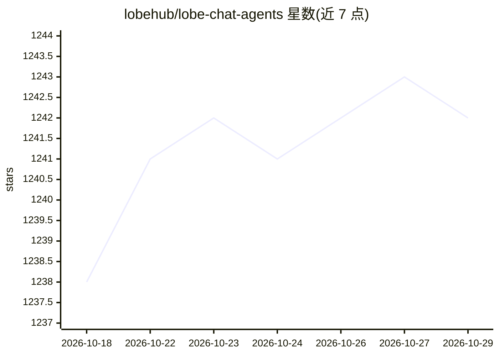

# lobehub/lobe-chat-agents

⭐ 1,242 · TypeScript · MIT · 推送 2026-10-15 · [GitHub](https://github.com/lobehub/lobe-chat-agents) · [官网](https://lobechat.com/discover/assistants) · 组织维护 · 中文 README

**LobeChat 的 agent 提示词索引：聚合社区提交的聊天 agent 清单**

LobeHub 维护的 LobeChat 插件式 agent 索引仓库：LobeChat 通过读取本仓库的 index.json 在 agent 市场展示可用 agent 列表。每个 agent 是一份含描述与标签的提示词配置（如海龟汤主持人、学术写作助手、翻译助手等），社区通过 fork 仓库、复制 agent-template.json 模板填写后提交 PR，经人工审核后收录，createAt 日期在合并后自动填入。非作者也可代为提交，但不保证全部收录。

## 筛选速览

| 维度 | 判定 | 备注 |
|---|---|---|
| AI 角色 | `ai-knowledge` | 知识聚合/清单类 |
| 许可风险 | `permissive` | MIT |
| 部署形态 | `self-host` | docker 或自建部署 |
| 模型依赖 | — | README 未给出锁定关系 |
| 硬件要求 | — | 无带数字的原话,不猜 |
| 安装摩擦 | `low` | 无编译、无系统依赖或容器化 |
| 成熟度 | — | 结构信号不足 |

## 能力要点

- 以 JSON 模板（agent-template.json / agent-template-full.json）标准化每个 agent 条目
- 社区通过 fork + PR 提交，合并前经人工审核
- LobeChat 运行时读取 index.json 展示 agent 市场
- 条目覆盖翻译、学术写作、编程、角色扮演等多类提示词

## 适用场景

- 为 LobeChat 查找和安装社区贡献的 agent
- 将自己设计的提示词 agent 发布到 LobeChat 市场
- 浏览社区 agent 提示词的写法与标签组织方式

## 场景标签

`精选清单` · 领域:学习与行业

## 证据(README 行号)

> L5: Lobe Chat accesses [`Agents Index`][website-url] from this repo to show user the list of available agents for LobeCh
> L33: If you wish to add an agent onto the index, make an entry in `agents` directory using `agent-template.json` or `age

## 星数曲线

2026-10-18 1,238 → 2026-10-29 1,242（+4）

---
*卡片 v1 · prompt 1.4 · 生成 2026-10-21 · 置信度 mid · 依据 README sha `67f3204f4cdb` · [字段定义](../../DATASET.md)*
