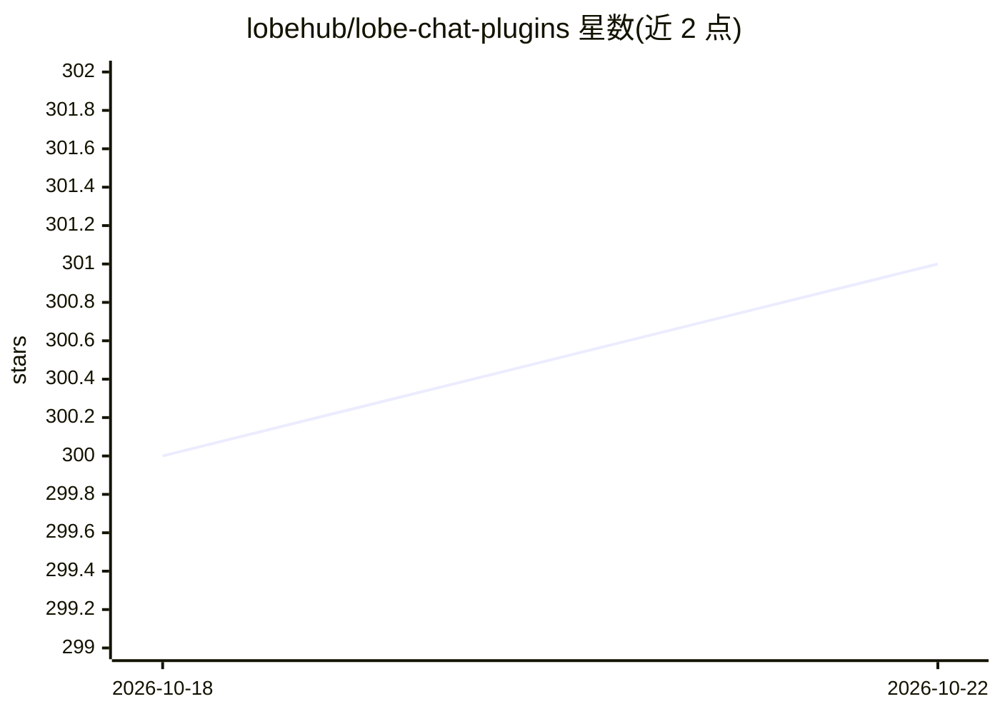

# lobehub/lobe-chat-plugins

⭐ 302 · TypeScript · 推送 2026-10-15 · [GitHub](https://github.com/lobehub/lobe-chat-plugins) · [官网](https://lobechat.com/discover/plugin) · 组织维护 · 中文 README

**LobeChat 官方插件索引：聚合 Function Calling 插件供用户浏览安装**

LobeHub 维护的插件索引仓库：LobeChat 通过读取本仓库的 index.json 向用户展示可用插件列表，收录 SEO 助手、网页搜索、天气、视频字幕、股票分析、图像生成等插件条目，每条含作者、日期、简介与标签。提交插件通过复制 plugin-template.json 并发起 PR，收录需审核且插件须可正常运作；失效插件可能被移除或重定向。仓库本身支持 Vercel 自部署与 git clone 后用 bun 进行本地开发。

## 筛选速览

| 维度 | 判定 | 备注 |
|---|---|---|
| AI 角色 | `ai-knowledge` | 知识聚合/清单类 |
| 许可风险 | `none` | — |
| 部署形态 | `None` |  |
| 模型依赖 | — | README 未给出锁定关系 |
| 硬件要求 | — | 无带数字的原话,不猜 |
| 安装摩擦 | `low` | 无编译、无系统依赖或容器化 |
| 成熟度 | — | 结构信号不足 |

## 能力要点

- 为 LobeChat Function Calling 提供插件索引（index.json）
- 插件条目含作者、日期、简介与标签，经 PR 审核收录
- 支持 Vercel 一键部署私有插件索引
- 本地开发基于 bun，format 脚本需配置 OPENAI_API_KEY

## 适用场景

- 在 LobeChat 中浏览和安装社区插件扩展功能
- 将自己开发的插件提交到官方索引获得曝光
- 自部署一个私有的 LobeChat 插件索引服务

## 场景标签

`精选清单` · 领域:学习与行业

## 证据(README 行号)

> L5: Lobe Chat accesses [`Plugins Index`][website-url] from this repo to show user the list of available plugins for Func
> L26: If you wish to add a plugin onto the index, make an entry in `plugins` directory using `plugin-template.json`, writ

## 星数曲线

2026-10-18 300 → 2026-10-22 301（+1）

---
*卡片 v1 · prompt 1.4 · 生成 2026-10-21 · 置信度 high · 依据 README sha `632c4fe493b6` · [字段定义](../../DATASET.md)*
