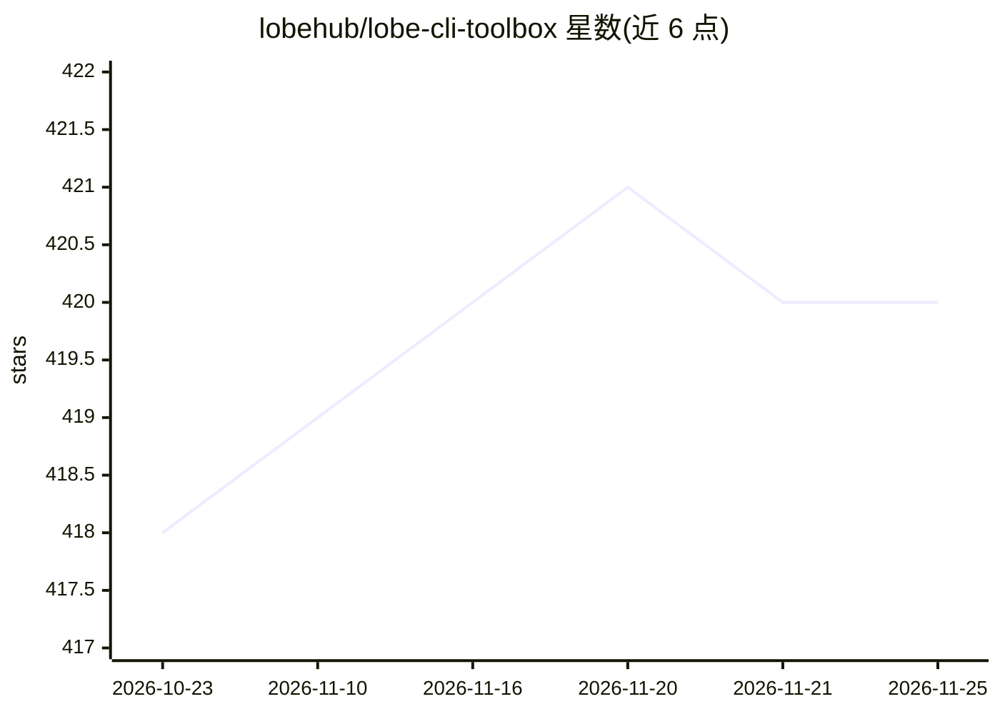

# lobehub/lobe-cli-toolbox

⭐ 420 · TypeScript · MIT · 推送 2026-11-22 · [GitHub](https://github.com/lobehub/lobe-cli-toolbox) · 组织维护 · 中文 README

**AI CLI 工具集：生成 Gitmoji 提交信息与自动化 i18n 翻译流程**

LobeHub 维护的 CLI 工具合集，包含五个子工具：Lobe Commit 借助 Langchain/ChatGPT 生成基于 Gitmoji 的提交信息；Lobe i18n 用 ChatGPT 自动化国际化翻译流程，支持大文件自动拆分、增量更新，可自定义 OpenAI 模型、API 代理与温度参数；Lobe label 自动从模板仓库复制 issue 标签；Lobe SEO 用 ChatGPT 为 MDX 文件生成 SEO 内容。各工具独立发布版本，仓库提供 pnpm 工作流的本地开发与构建说明，MIT 许可。

## 筛选速览

| 维度 | 判定 | 备注 |
|---|---|---|
| AI 角色 | `ai-native` | 本体是模型或模型工具 |
| 许可风险 | `permissive` | MIT |
| 部署形态 | `library` | 以包/库形式分发 |
| 模型依赖 | — | README 未给出锁定关系 |
| 硬件要求 | — | 无带数字的原话,不猜 |
| 安装摩擦 | `low` | 无编译、无系统依赖或容器化 |
| 成熟度 | — | 结构信号不足 |

## 能力要点

- Lobe Commit：基于 Langchain/ChatGPT 生成 Gitmoji 格式提交信息
- Lobe i18n：支持大文件自动拆分与增量更新的翻译自动化
- 可自定义 OpenAI 模型、API 代理与 temperature 参数
- Lobe SEO：为 MDX 自动生成 SEO 内容

## 适用场景

- 为提交记录生成符合 Gitmoji 规范的提交信息
- 对项目文案做批量国际化翻译并增量维护
- 为 MDX 文档批量生成 SEO 元信息

## 场景标签

`AI 写作` · 领域:内容生成

## 证据(README 行号)

> L21: |[**💌 Lobe Commit**][lobe-commit-github] [(中文)][lobe-commit-github-cn] CLI tool that leverages Langchain/ChatGPT to
> L23: |[**🌏 Lobe i18n**][lobe-i18n-github] [(中文)][lobe-i18n-github-cn] Automation tool for the i18n (internationalization

## 星数曲线

2026-10-23 418 → 2026-11-25 420（+2）

---
*卡片 v1 · prompt 1.4 · 生成 2026-11-25 · 置信度 mid · 依据 README sha `02e2bcb2ffeb` · [字段定义](../../DATASET.md)*
