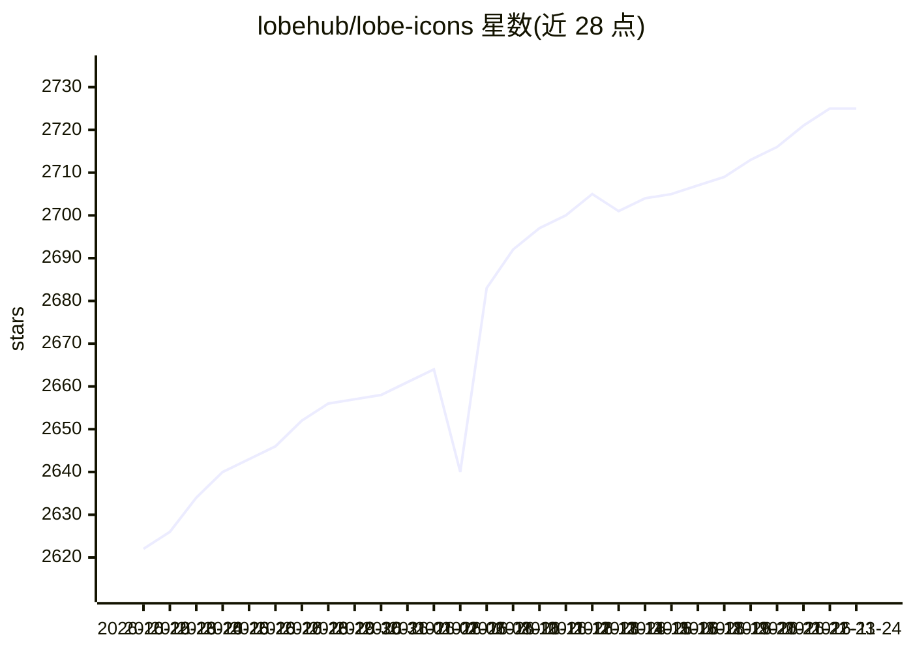

# lobehub/lobe-icons

⭐ 2,725 · TypeScript · MIT · 推送 2026-11-22 · [GitHub](https://github.com/lobehub/lobe-icons) · [官网](https://icons.lobehub.com) · 组织维护 · 中文 README

**为 React/React Native 应用提供 340+ AI 品牌 logo 的图标库**

收录 340+ AI 模型、服务商与应用品牌的图标资源，支持 React、React Native 组件形式与静态 SVG/PNG/WEBP 图片，提供 mono/color/text/avatar 四种样式以适配明暗主题。可通过传入模型或服务商 id（如 gpt-4o、openai）获取对应 logo，支持按需导入以减小打包体积。安装要求 React 19，@lobehub/ui 为 peer dependency；另提供 Vue 3 包与 CDN 图片 URL 用法，并附 skills.md 与 llms.txt 供编码 agent 读取。

## 筛选速览

| 维度 | 判定 | 备注 |
|---|---|---|
| AI 角色 | `ai-ecosystem` | LLM/agent 周边工具 |
| 许可风险 | `permissive` | MIT |
| 部署形态 | `library` | 以包/库形式分发 |
| 模型依赖 | — | README 未给出锁定关系 |
| 硬件要求 | — | 无带数字的原话,不猜 |
| 安装摩擦 | `low` | 无编译、无系统依赖或容器化 |
| 成熟度 | — | 结构信号不足 |

## 能力要点

- 340+ AI 品牌 logo，提供 React / React Native / Vue 3 组件与静态 SVG/PNG/WEBP
- 传入模型或服务商 id 直接返回对应图标
- mono/color/text/avatar 四种样式适配明暗主题
- 提供 skills.md 与 llms.txt 供编码 agent 学习使用

## 适用场景

- 在 AI 应用界面中展示模型与服务商品牌图标
- 通过 CDN 图片 URL 在纯 HTML 页面中使用 AI 品牌 logo
- 让编码 agent 按文档自动接入图标库

## 场景标签

 · 领域:前端组件/设计资源

## 证据(README 行号)

> L5: 340+ AI model and provider logos, ready for React, React Native, or as static SVG / PNG / WEBP.
> L34: The logos of the AI world, ready to drop into your app: 300+ AI / LLM model, provider and application brands.
> L40: - **Use it anywhere**: React, React Native, or plain image URLs from a CDN.

## 星数曲线

2026-10-22 2,622 → 2026-11-24 2,725（+103）

---
*卡片 v1 · prompt 1.4 · 生成 2026-11-23 · 置信度 high · 依据 README sha `fe3e81ee04d9` · [字段定义](../../DATASET.md)*
