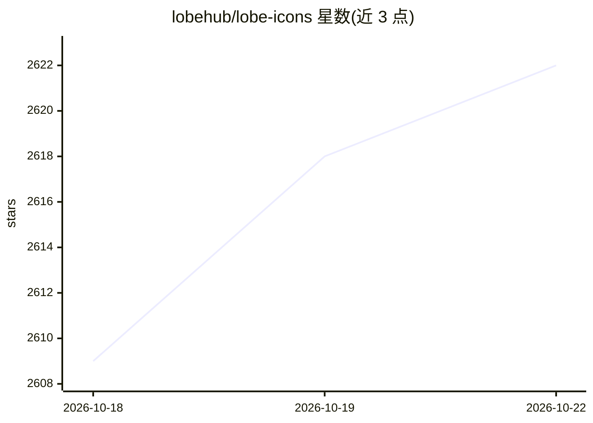

# lobehub/lobe-icons

⭐ 2,626 · TypeScript · MIT · 推送 2026-10-22 · [GitHub](https://github.com/lobehub/lobe-icons) · [官网](https://icons.lobehub.com) · 组织维护 · 中文 README

**AI/LLM 品牌图标库：为 React 应用提供静态 SVG/PNG/WebP 图标**

面向 React 与 React Native 开发者的 AI/LLM 品牌 Logo 与图标集合，以 6 个 npm 包分发（React 组件包、React Native 包及静态 SVG/PNG/WebP/Avatar 包），采用可摇树（tree-shakable）的 SVG 设计，无额外依赖。收录模型、厂商、应用三类品牌图标（Claude、DeepSeek、Doubao 等），支持在 lobehub.com/icons 单页浏览全部图标，并接受 GitHub 上的贡献、更正与请求。另提供供 AI Agent 使用的技能提示安装方式。

## 筛选速览

| 维度 | 判定 | 备注 |
|---|---|---|
| AI 角色 | `ai-knowledge` | 知识聚合/清单类 |
| 许可风险 | `permissive` | MIT |
| 部署形态 | `library` | 以包/库形式分发 |
| 模型依赖 | — | README 未给出锁定关系 |
| 硬件要求 | — | 无带数字的原话,不猜 |
| 安装摩擦 | `low` | 无编译、无系统依赖或容器化 |
| 成熟度 | — | 结构信号不足 |

## 能力要点

- 6 个 npm 包形态：React / React Native 组件包与静态 SVG/PNG/WebP 包
- tree-shakable，仅打包所导入的图标
- 收录大量模型/厂商/应用品牌，含中英文品牌条目
- 提供 Agent 用 prompt 安装方式

## 适用场景

- 在 AI 应用界面中展示各模型与厂商的官方 Logo
- React Native 移动端使用品牌图标
- 静态站点直接引用 SVG/PNG/WebP 图标资源

## 场景标签

 · 领域:设计资产/前端组件

## 证据(README 行号)

> L3: Popular AI / LLM Model Brand SVG Logo and Icon Collection. See them all on one page at lobehub.com/icons.
> L53: |React logo|**`@lobehub/icons`**|npm|NPM Downloads|Source|
> L57: |WebP logo|**`@lobehub/icons-static-webp`**|npm|NPM Downloads|Source|

## 星数曲线

2026-10-18 2,609 → 2026-10-22 2,622（+13）

---
*卡片 v1 · prompt 1.4 · 生成 2026-10-21 · 置信度 high · 依据 README sha `a00106764dc8` · [字段定义](../../DATASET.md)*
