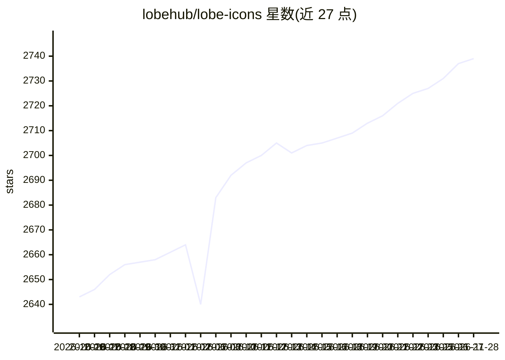

# lobehub/lobe-icons

⭐ 2,739 · TypeScript · MIT · 推送 2026-11-23 · [GitHub](https://github.com/lobehub/lobe-icons) · [官网](https://icons.lobehub.com) · 组织维护 · 中文 README

**面向 React/React Native 应用的 340+ AI/LLM 品牌 Logo 图标库**

Lobe Icons 收录 340+ AI 模型、服务商与应用品牌的 Logo，以 React 与 React Native 组件形式提供，同时发布静态 SVG/PNG/WEBP 资源。组件支持 mono、color、text、avatar 四种样式适配明暗主题，可传入模型或服务商 id（如 gpt-4o、openai）获取对应 Logo，按需导入以减小包体积，也可不经框架直接通过 CDN URL 引用图片。另提供 skills.md、llms.txt 与技能文件供编码代理读取使用。安装依赖 React 19，@lobehub/ui 为 peer dependency。

## 筛选速览

| 维度 | 判定 | 备注 |
|---|---|---|
| AI 角色 | `ai-enhanced` | 去掉 AI 部分产品仍成立 |
| 许可风险 | `permissive` | MIT |
| 部署形态 | `library` | 以包/库形式分发 |
| 模型依赖 | — | README 未给出锁定关系 |
| 硬件要求 | — | 无带数字的原话,不猜 |
| 安装摩擦 | `low` | 无编译、无系统依赖或容器化 |
| 成熟度 | — | 结构信号不足 |

## 能力要点

- 340+ AI/LLM 品牌图标，覆盖模型、服务商与应用品牌
- 传入模型/服务商 id 直接获取对应 Logo 组件
- 提供 SVG/PNG/WEBP 静态资源与 CDN 直链（含明暗两套）
- 提供 skills.md 与 llms.txt 供编码代理学习使用

## 适用场景

- 在 AI 应用界面中展示所接入模型或服务商的品牌图标
- 在官网或文档中通过 CDN 链接直接引用 AI 品牌 Logo
- React Native/Expo 应用中渲染 AI 品牌 Logo
- 让编码代理按 skills.md 自动接入图标组件

## 场景标签

 · 领域:前端开发/设计资源

## 证据(README 行号)

> L5: 340+ AI model and provider logos, ready for React, React Native, or as static SVG / PNG / WEBP.
> L34: The logos of the AI world, ready to drop into your app: 300+ AI / LLM model, provider and application brands.
> L40: - **Use it anywhere**: React, React Native, or plain image URLs from a CDN.

## 星数曲线

2026-10-26 2,643 → 2026-11-28 2,739（+96）

---
*卡片 v1 · prompt 1.4 · 生成 2026-11-24 · 置信度 high · 依据 README sha `fa11df1aeb83` · [字段定义](../../DATASET.md)*
