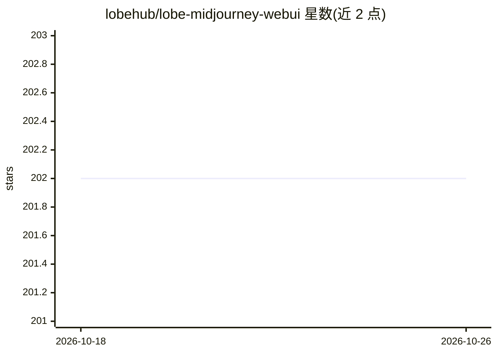

# lobehub/lobe-midjourney-webui

⭐ 202 · TypeScript · MIT · 推送 2026-10-25 · [GitHub](https://github.com/lobehub/lobe-midjourney-webui) · [官网](https://midjourney-webui.lobehub.com) · 组织维护 · 中文 README

**LobeChat 的 Midjourney 绘图插件：自然语言生成图片**

LobeHub 维护的 LobeChat 插件与独立 Web UI，接入 Midjourney 服务实现文本生成图片：自然语言激活插件面板、自定义 prompt、风格/宽高比等参数设置、专用生成与预览界面。依赖用户自部署的 midjourney-proxy 作为服务提供方，也支持在网页中独立使用。本地开发通过 git clone 加 pnpm 启动。

## 筛选速览

| 维度 | 判定 | 备注 |
|---|---|---|
| AI 角色 | `ai-native` | 本体是模型或模型工具 |
| 许可风险 | `permissive` | MIT |
| 部署形态 | `library` | 以包/库形式分发 |
| 模型依赖 | — | README 未给出锁定关系 |
| 硬件要求 | — | 无带数字的原话,不猜 |
| 安装摩擦 | `low` | 无编译、无系统依赖或容器化 |
| 成熟度 | — | 结构信号不足 |

## 能力要点

- 通过设置 Midjourney proxy URL 接入 Midjourney 服务
- 自然语言 prompt 激活插件面板生成图片
- 支持风格、宽高比、细节等参数设置
- 提供专用 UI 生成与预览图片，可网页独立使用

## 适用场景

- 在 LobeChat 对话中直接生成 Midjourney 图片
- 在网页端独立使用 Midjourney 绘图界面
- 自定义 prompt 与参数控制生成效果

## 场景标签

`图像生成` · 领域:内容生成

## 证据(README 行号)

> L30: - 🖼️ **AI Image Generation**: The Midjourney plugin leverages AI to quickly generate a wide array of rich and diver
> L44: This plugin relies on midjourney-proxy as the provider for Midjourney services. You will need to deploy a midjourne

## 星数曲线

2026-10-18 202 → 2026-10-26 202（+0）

---
*卡片 v1 · prompt 1.4 · 生成 2026-10-22 · 置信度 mid · 依据 README sha `e2da08c69200` · [字段定义](../../DATASET.md)*
