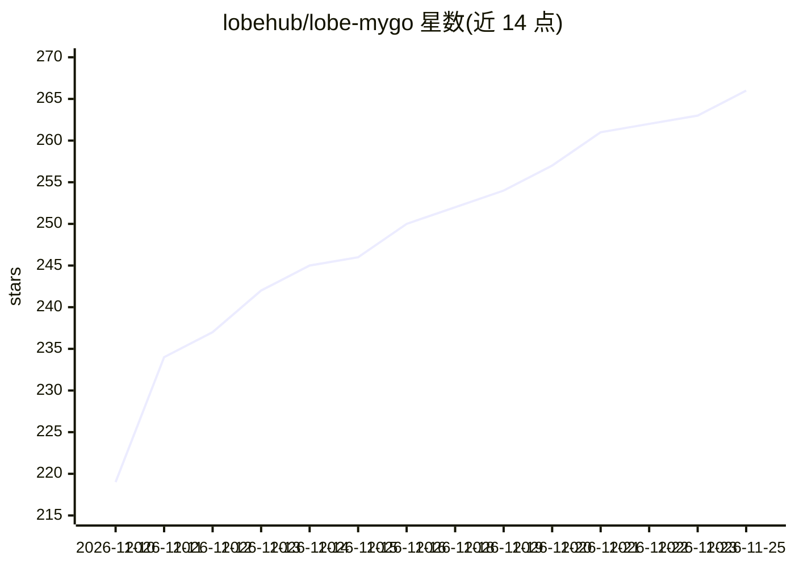

# lobehub/lobe-mygo

⭐ 266 · Go · MIT · 推送 2026-11-16 · [GitHub](https://github.com/lobehub/lobe-mygo) · [官网](https://mygo.lobehub.com) · 组织维护 · 中文 README

**Go 桌面应用的 Lobe UI 组件库，纯 Go GPU 绘制**

将 Lobe UI 设计语言移植到 MyGo 原生桌面应用的 Go UI 组件库：70+ 组件（按钮、输入、菜单、弹窗、标签页等），设计 token 由 @lobehub/ui 生成使 Go 应用与 Web 应用外观一致；支持明暗主题跟随系统、弹性动画、2300+ Lucide 图标、Markdown 流式渲染。纯 Go 无 cgo，可交叉编译为单二进制；需 Go 1.27+，提供桌面应用骨架示例与双语（英/简中）文案。

## 筛选速览

| 维度 | 判定 | 备注 |
|---|---|---|
| AI 角色 | `ai-ecosystem` | LLM/agent 周边工具 |
| 许可风险 | `permissive` | MIT |
| 部署形态 | `None` |  |
| 模型依赖 | — | README 未给出锁定关系 |
| 硬件要求 | — | 无带数字的原话,不猜 |
| 安装摩擦 | `low` | 无编译、无系统依赖或容器化 |
| 成熟度 | — | 结构信号不足 |

## 能力要点

- 70+ 组件覆盖操作、表单、反馈、导航、布局等 12 个包
- 设计 token 由 @lobehub/ui 生成，与 Web 端共享外观
- 纯 Go 无 cgo，跨平台单二进制交叉编译
- 2300+ Lucide 图标以 Go 函数提供

## 适用场景

- 用 MyGo 开发原生桌面应用并保持 Lobe UI 设计语言
- Go 应用与已有 Web 应用共享同一套视觉规范
- 基于 examples/desktop 骨架快速搭建带侧栏、标签页的桌面应用

## 场景标签

 · 领域:桌面 UI/设计系统

## 证据(README 行号)

> L7: Lobe UI components for MyGo native UI, drawn on the GPU in pure Go.
> L143: - **🍭 Lobe UI** - React component library for AI apps

## 星数曲线

2026-11-10 219 → 2026-11-25 266（+47）

---
*卡片 v1 · prompt 1.4 · 生成 2026-11-17 · 置信度 mid · 依据 README sha `7e00153f331c` · [字段定义](../../DATASET.md)*
