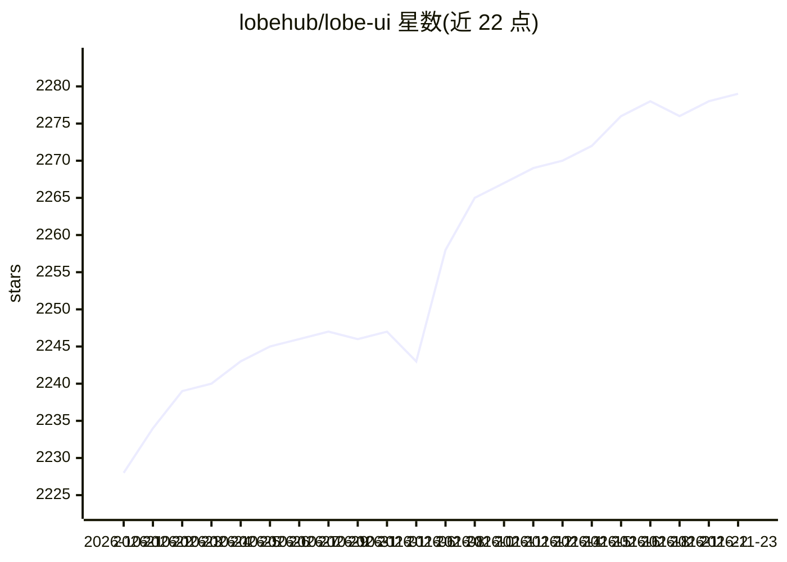

# lobehub/lobe-ui

⭐ 2,279 · TypeScript · MIT · 推送 2026-11-22 · [GitHub](https://github.com/lobehub/lobe-ui) · [官网](https://ui.lobehub.com) · 组织维护

**为开发者提供构建 AI 聊天与 AIGC Web 应用的 React 组件库**

LobeHub 的开源 React 组件库，用于构建 AI 聊天与 AIGC Web 应用。提供渲染 LLM 输出（Markdown、代码、Mermaid 图、diff、HTML 预览）的组件与聊天界面，覆盖从落地页到管理后台的统一设计语言；支持单属性切换明暗主题与主色，类名稳定可用 CSS/Tailwind 覆写，内置英文与简体中文文案。ESM-only，依赖 React 19 及若干 peer 依赖；v6 起移除 Ant Design。文档面向编码代理提供 skills.md 与 llms.txt，并附 v6 迁移 skill 与 Codemod。

## 筛选速览

| 维度 | 判定 | 备注 |
|---|---|---|
| AI 角色 | `ai-ecosystem` | LLM/agent 周边工具 |
| 许可风险 | `permissive` | MIT |
| 部署形态 | `library` | 以包/库形式分发 |
| 模型依赖 | — | README 未给出锁定关系 |
| 硬件要求 | — | 无带数字的原话,不猜 |
| 安装摩擦 | `low` | 无编译、无系统依赖或容器化 |
| 成熟度 | — | 结构信号不足 |

## 能力要点

- 渲染 LLM 输出的组件：Markdown、代码、Mermaid、diff、HTML 预览
- 单属性切换明暗模式与主色，无首载闪烁
- 面向编码代理的 skills.md / llms.txt 文档与 v6 迁移 Codemod
- 多个入口包：chat、mobile、dashboard、pro-table、form 等

## 适用场景

- 用 React 搭建 AI 聊天界面而无需从零实现
- 构建 AIGC Web 应用的落地页与后台管理界面
- 让编码代理依据组件文档生成页面代码

## 场景标签

 · 领域:前端开发/UI 组件库

## 证据(README 行号)

> L5: LobeHub's open-source React component library for building AI chat and AIGC web apps.
> L32: Lobe UI is the React component library behind LobeHub, made for building AI chat and AIGC web apps.
> L39: - **AI-native docs**: coding agents read every component's usage and props through skills.md and llms.txt.

## 星数曲线

2026-10-21 2,228 → 2026-11-23 2,279（+51）

---
*卡片 v1 · prompt 1.4 · 生成 2026-11-23 · 置信度 high · 依据 README sha `81d9c3855720` · [字段定义](../../DATASET.md)*
