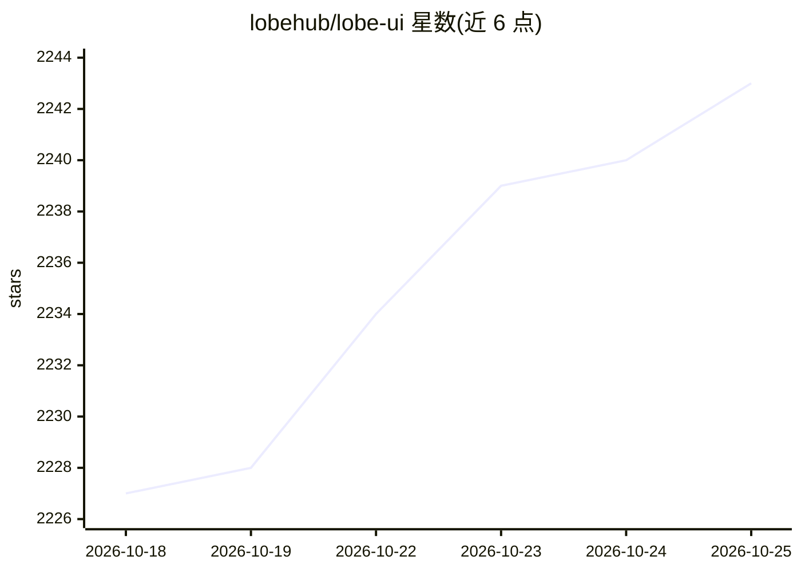

# lobehub/lobe-ui

⭐ 2,243 · TypeScript · MIT · 推送 2026-10-23 · [GitHub](https://github.com/lobehub/lobe-ui) · [官网](https://ui.lobehub.com) · 组织维护 · 中文 README

**构建 AIGC Web 应用的开源 React UI 组件库**

LobeHub 维护的 TypeScript/React 组件库，面向构建 AIGC Web 应用的开发者。提供基于级联层（lobe-base/lobe-popup/lobe-ui）的样式体系、data-attribute 运行时主题（外观/主色/中性色）、ThemeScope 子树主题、i18n 资源包、依赖 motion/react 动画的 ConfigProvider，以及 StyleX token 复用与 Tailwind v4 共存方案。包为 ESM only，NextJS page router SSR 需配置 transpilePackages，v5 升级 v6 提供 codemod 迁移命令。

## 筛选速览

| 维度 | 判定 | 备注 |
|---|---|---|
| AI 角色 | `ai-ecosystem` | LLM/agent 周边工具 |
| 许可风险 | `permissive` | MIT |
| 部署形态 | `library` | 以包/库形式分发 |
| 模型依赖 | — | README 未给出锁定关系 |
| 硬件要求 | — | 无带数字的原话,不猜 |
| 安装摩擦 | `low` | 无编译、无系统依赖或容器化 |
| 成熟度 | — | 结构信号不足 |

## 能力要点

- ESM only 的 React UI 组件库，pnpm add @lobehub/ui 安装
- CSS 级联层（lobe-base/lobe-popup/lobe-ui）与 Tailwind v4 共存方案
- data-attribute 主题系统与运行时 setLobeTheme / ThemeScope
- 内置 i18n provider 与组件 texts 属性文本定制

## 适用场景

- 为 AIGC 聊天应用快速搭建界面组件
- 在 NextJS / Tailwind v4 项目中接入并定制主题
- 为组件做多语言文本切换

## 场景标签

 · 领域:前端/UI 组件库

## 证据(README 行号)

> L3: Lobe UI is an open-source UI component library for building _AIGC_ web apps
> L184: - **🍭 Lobe UI** - An open-source UI component library for building AIGC web apps.

## 星数曲线

2026-10-18 2,227 → 2026-10-25 2,243（+16）

---
*卡片 v1 · prompt 1.4 · 生成 2026-10-21 · 置信度 high · 依据 README sha `fb2e08f7be5c` · [字段定义](../../DATASET.md)*
