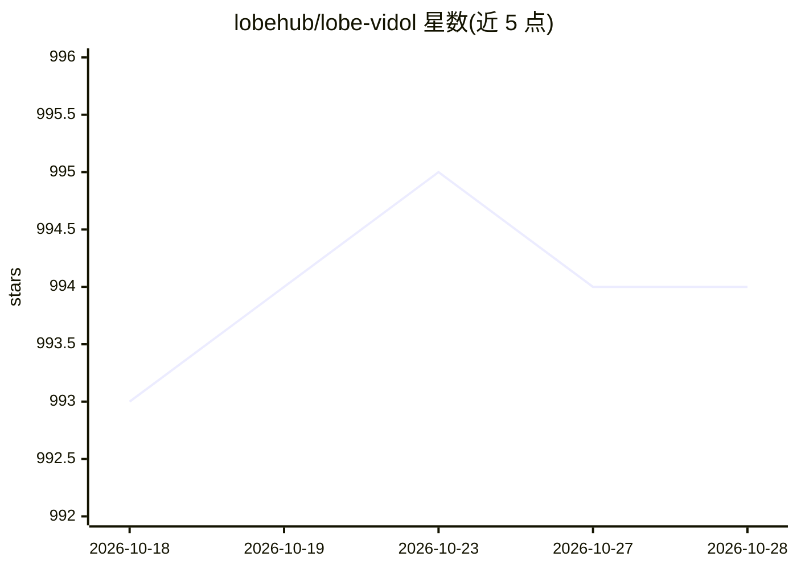

# lobehub/lobe-vidol

⭐ 994 · TypeScript · Apache-2.0 · 推送 2026-10-15 · [GitHub](https://github.com/lobehub/lobe-vidol) · [官网](https://vidol.lobehub.com) · 组织维护 · 中文 README

**面向用户的虚拟偶像创作与对话平台**

LobeHub 团队开发的 Web 应用：用户可创建虚拟偶像角色、上传 VRM 模型、设置触摸反应，与角色进行流式文本对话和视频模式互动；内置 Mixamo 动作库，通过 mmd-parser 支持 VMD 舞蹈与 PMX 舞台加载，并提供角色与舞蹈市场。支持多家模型服务商接入，具备 TTS/STT 语音对话，以 PWA 形式部署。当前处于 Beta 阶段，本地开发依赖 Bun，可直接访问官网免安装体验。

## 筛选速览

| 维度 | 判定 | 备注 |
|---|---|---|
| AI 角色 | `ai-native` | 本体是模型或模型工具 |
| 许可风险 | `permissive` | Apache-2.0 |
| 部署形态 | `None` |  |
| 模型依赖 | locked-api |  |
| 硬件要求 | — | 无带数字的原话,不猜 |
| 安装摩擦 | `low` | 无编译、无系统依赖或容器化 |
| 成熟度 | — | 结构信号不足 |

## 能力要点

- 文本与视频双模式对话，支持背景/舞台/动作/舞蹈设置
- 角色编辑器可创建虚拟偶像、上传 VRM 模型、设置触摸反应
- 支持 AWS Bedrock、Anthropic、Gemini、Qwen、DeepSeek 等多家模型服务商
- TTS/STT 语音对话（OpenAI Audio、Microsoft Edge Speech 音源）

## 适用场景

- 创建并定制自己的虚拟偶像角色进行对话
- 让角色随 MMD 舞蹈文件或内置动作起舞
- 在角色/舞蹈市场分享和获取创作内容

## 场景标签

`聊天机器人` · 领域:对话与助手

## 证据(README 行号)

> L55: Streamed responses provide a smooth conversational experience, allowing you to create an immersive dialogue by sett
> L93: The diversity of model providers is crucial for meeting community needs when providing AI conversation services. Th
> L133: LobeVidol supports Text-to-Speech (TTS) and Speech-to-Text (STT) technologies, enabling our application to convert

## 星数曲线

2026-10-18 993 → 2026-10-28 994（+1）

---
*卡片 v1 · prompt 1.4 · 生成 2026-10-21 · 置信度 high · 依据 README sha `5aa0b6039309` · [字段定义](../../DATASET.md)*
