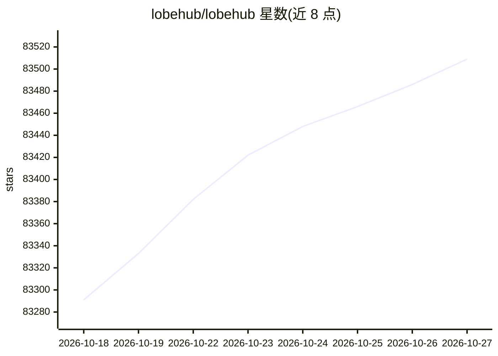

# lobehub/lobehub

⭐ 83,509 · TypeScript · NOASSERTION · 推送 2026-10-26 · [GitHub](https://github.com/lobehub/lobehub) · [官网](https://lobehub.com) · 组织维护 · 中文 README

**多智能体协作平台：像团队一样雇佣、调度、汇报 AI 代理**

LobeHub 是一个面向多智能体协作的工作空间：以 Agent 为工作单元，提供 Agent Builder 一键生成智能体配置、Agent Groups 并行协作、Pages 共享上下文协作写作、Schedule 定时运行、Workspace 团队空间，以及结构化可编辑的 Personal Memory 持续学习机制。声称支持 10,000+ 技能工具与 MCP 兼容插件。支持通过 Vercel、Zeabur、Sealos、阿里云或 Docker 镜像自行部署，配置 OPENAI_API_KEY 等环境变量后使用。README 注明项目仍在活跃开发中。

## 筛选速览

| 维度 | 判定 | 备注 |
|---|---|---|
| AI 角色 | `ai-native` | 本体是模型或模型工具 |
| 许可风险 | `none` | NOASSERTION |
| 部署形态 | `self-host` | docker 或自建部署 |
| 模型依赖 | — | README 未给出锁定关系 |
| 硬件要求 | — | 无带数字的原话,不猜 |
| 安装摩擦 | `low` | 无编译、无系统依赖或容器化 |
| 成熟度 | `idea` | |

## 动量与使用信号

- 维护:`active` — 距上次 push 0.6 天,年发版 100,353 位贡献者
- 涨星:近 1 天 **+23**(自 20261016 起算)
- 平台:WINDOWS · 协议:OPENAI-API / MCP

## 能力要点

- Agent Builder 一句话生成智能体配置
- Agent Groups 多智能体并行协作与定时调度
- 10,000+ 工具/MCP 兼容插件库
- 结构化、可编辑的白盒 Personal Memory

## 适用场景

- 把多个 AI 智能体组成团队按项目协作
- 通过定时任务让代理在离线时执行工作
- 在团队工作区中与智能体共享上下文协作
- 自托管私人聊天机器人服务

## 场景标签

`多智能体` `聊天机器人` `Agent 记忆` · 领域:Agent 开发

## 证据(README 行号)

> L76: LobeHub is a work-and-lifestyle space to find, build, and collaborate with agent teammates that grow with you. In L
> L93: - **Unified Intelligence**: Seamlessly access any model and any modality—all under your control.
> L128: LobeHub provides Self-Hosted Version with Vercel, Alibaba Cloud, and [Docker Image][docker-release-link]. This all

## 星数曲线

2026-10-18 83,291 → 2026-10-27 83,509（+218）

---
*卡片 v1 · prompt 1.4 · 生成 2026-10-18 · 置信度 mid · 依据 README sha `93a11e8cdb2d` · [字段定义](../../DATASET.md)*
