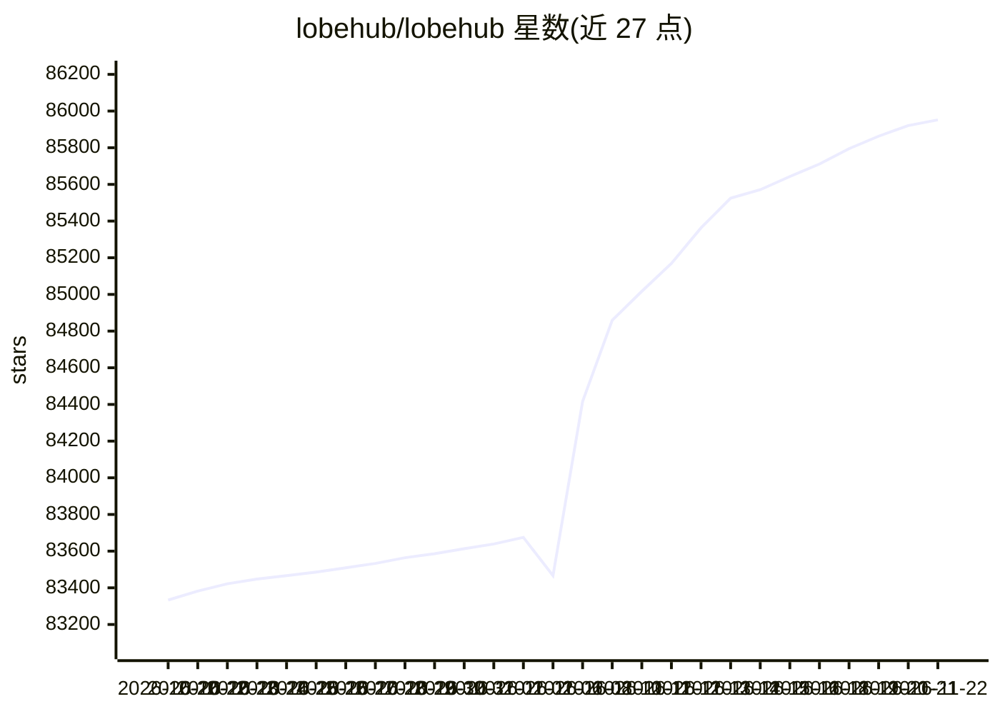

# lobehub/lobehub

⭐ 85,952 · TypeScript · NOASSERTION · 推送 2026-11-21 · [GitHub](https://github.com/lobehub/lobehub) · [官网](https://lobehub.com) · 组织维护 · 中文 README

**给团队聊天中添加能自主执行任务的 super-agent 平台**

LobeHub 是一个多 agent 平台：用户把 agent 加入团队已有的聊天工具（Discord/Slack/Telegram/QQ/微信/飞书等），agent 可自主领取任务、并行处理、在原线程回报，GitHub 集成使 PR 合并即视为接受工作。平台内置 Lobe AI agent，支持多 agent 协作（顺序/并行/迭代/辩论）、任务委派与定时、结构化记忆、Markdown 长文写作。附 Marketplace 供发布和获取 agents、MCP servers 与 SKILL.md 格式 skills。可云端使用或通过 Docker Compose/Vercel 等自托管。

## 筛选速览

| 维度 | 判定 | 备注 |
|---|---|---|
| AI 角色 | `ai-ecosystem` | LLM/agent 周边工具 |
| 许可风险 | `none` | NOASSERTION |
| 部署形态 | `self-host` | docker 或自建部署 |
| 模型依赖 | — | README 未给出锁定关系 |
| 硬件要求 | — | 无带数字的原话,不猜 |
| 安装摩擦 | `low` | 无编译、无系统依赖或容器化 |
| 成熟度 | — | 结构信号不足 |

## 动量与使用信号

- 维护:`active` — 距上次 push 0.6 天,年发版 100,353 位贡献者
- 涨星:近 1 天 **+23**(自 20261016 起算)
- 平台:WINDOWS · 协议:OPENAI-API / MCP

## 能力要点

- 支持将 agent 接入 Discord、Slack、Telegram、QQ、微信、飞书等 IM 渠道
- GitHub 集成：跟踪 agent 的 PR，合并即接受、检查失败回传 agent
- Marketplace 提供 agents、MCP servers、SKILL.md 格式 skills 的发布与获取
- 文档覆盖 40+ 模型服务商的接入配置

## 适用场景

- 在团队聊天工具中部署自主执行任务的 AI agent
- 多个 agent 按顺序、并行或辩论方式协作完成工作
- 自托管一套带记忆与任务管理的 agent 工作台
- 发布自己的 agent 或 MCP server 到公开市场

## 场景标签

`多智能体` `Agent 框架` `AI 助手` · 领域:Agent 开发

## 证据(README 行号)

> L7: Add super-agents to the chats your team already uses.
> L173: |Agent Team|Several agents working together: sequential, parallel, iterative or debate|
> L174: |Connect External Agents|Bring in Claude Code, Codex, OpenClaw, Hermes and more, with project context and permissi

## 星数曲线

2026-10-20 83,333 → 2026-11-22 85,952（+2,619）

---
*卡片 v1 · prompt 1.4 · 生成 2026-11-22 · 置信度 mid · 依据 README sha `1786922f13aa` · [字段定义](../../DATASET.md)*
