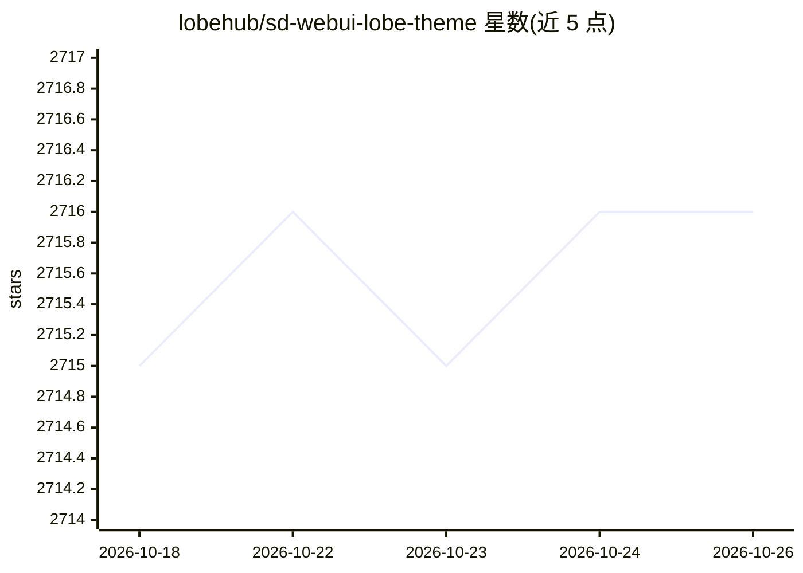

# lobehub/sd-webui-lobe-theme

⭐ 2,716 · TypeScript · AGPL-3.0 · 推送 2026-10-23 · [GitHub](https://github.com/lobehub/sd-webui-lobe-theme) · [官网](https://github.com/AUTOMATIC1111/stable-diffusion-webui) · 组织维护 · 中文 README

**给 Stable Diffusion WebUI 用户的现代化界面主题扩展**

Lobe Theme 是运行于 Stable Diffusion WebUI 之上的界面主题扩展，以 React/TypeScript 实现，提供明暗主题切换、13 套主题色与中性色定制、可配置侧边栏、Prompt 语法高亮与一键格式化、图像生成信息展示改进与一键复制、图像配方分享、Prompt 编辑器、移动端适配及 PWA 支持等。安装需 SD WebUI v1.6 及 gradio-3.41.2 以上，可通过 WebUI 扩展市场或 git clone 安装，v3 不向下兼容旧版本。

## 筛选速览

| 维度 | 判定 | 备注 |
|---|---|---|
| AI 角色 | `ai-ecosystem` | LLM/agent 周边工具 |
| 许可风险 | `viral` | AGPL-3.0 |
| 部署形态 | `None` |  |
| 模型依赖 | — | README 未给出锁定关系 |
| 硬件要求 | — | 无带数字的原话,不猜 |
| 安装摩擦 | `low` | 无编译、无系统依赖或容器化 |
| 成熟度 | `idea` | |

## 能力要点

- 明暗主题与 13 套主题色、6 级中性色的个性化定制
- Prompt 语法高亮与一键格式化（全半角转换、补逗号等）
- 可配置侧边栏与额外网络侧边栏（固定/浮动模式、宽度可调）
- 图像生成信息展示改进与 Seeds 一键复制、图像配方分享

## 适用场景

- 为本地 Stable Diffusion WebUI 更换可定制的界面主题
- 更高效地编写和管理生成图片的 Prompt
- 在移动设备上访问和操作 WebUI 界面

## 场景标签

`提示工程` · 领域:Agent 开发

## 证据(README 行号)

> L3: A modern interface framework designed for Stable Diffusion WebUI with an exquisite interface design, a highly custom
> L136: When using the Stable Diffusion model for Prompt writing,

## 星数曲线

2026-10-18 2,715 → 2026-10-26 2,716（+1）

---
*卡片 v1 · prompt 1.4 · 生成 2026-10-21 · 置信度 high · 依据 README sha `67fc207ddef8` · [字段定义](../../DATASET.md)*
