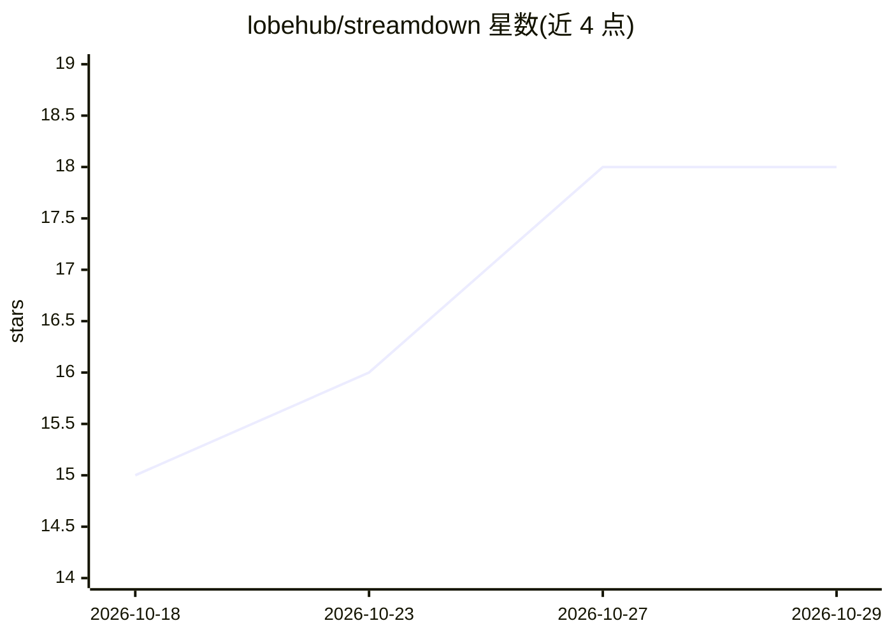

# lobehub/streamdown

⭐ 18 · TypeScript · MIT · 推送 2026-10-22 · [GitHub](https://github.com/lobehub/streamdown) · [官网](https://streamdown.lobehub.com) · 组织维护

**面向 LLM 流式输出的 React 无头 Markdown 渲染引擎**

LobeHub 维护的无头 React 组件库，用于渲染 LLM 持续流式到达的 Markdown：支持未闭合代码块、表格、粗体与 LaTeX 的容错渲染；已完成块缓存后仅重渲染开放尾块以降低更新开销；提供逐字/逐词渐显的三档节奏、LaTeX 未闭合时的守卫（保持最后一帧）、以及 preprocessLaTeX 预处理。无样式与组件依赖，插件透传给 react-markdown；ESM only，需 react/react-dom ^19 作为 peer 依赖。文档额外面向编码 agent 提供 skills.md 与 llms.txt。

## 筛选速览

| 维度 | 判定 | 备注 |
|---|---|---|
| AI 角色 | `ai-ecosystem` | LLM/agent 周边工具 |
| 许可风险 | `permissive` | MIT |
| 部署形态 | `library` | 以包/库形式分发 |
| 模型依赖 | — | README 未给出锁定关系 |
| 硬件要求 | — | 无带数字的原话,不猜 |
| 安装摩擦 | `low` | 无编译、无系统依赖或容器化 |
| 成熟度 | — | 结构信号不足 |

## 能力要点

- 流式 Markdown 容错渲染（未闭合代码块/表格/粗体/公式）
- 已完成块缓存，每次更新仅重渲染开放尾块
- 逐字/逐词渐显（realtime/balanced/silky 三档）与 LaTeX 未闭合守卫
- 无头设计：不带样式与组件依赖，插件透传 react-markdown

## 适用场景

- 在聊天应用中流式渲染 LLM 助手的 Markdown 回复
- 渲染包含 GFM 表格与数学公式的流式内容而不闪烁源码
- 以自带排版与代码高亮方案定制 Markdown 展示

## 场景标签

 · 领域:前端/LLM 应用界面

## 证据(README 行号)

> L5: LobeHub's headless React renderer for markdown that streams in from LLMs. It caches finished blocks, reveals text sm
> L32: Streamdown renders the markdown an LLM has sent so far, and keeps rendering it as the rest arrives.
> L38: - **Headless**: no stylesheet and no component dependencies. Bring your own typography, highlighter and plugins.

## 星数曲线

2026-10-18 15 → 2026-10-29 18（+3）

---
*卡片 v1 · prompt 1.4 · 生成 2026-10-29 · 置信度 high · 依据 README sha `e572b534cb04` · [字段定义](../../DATASET.md)*
