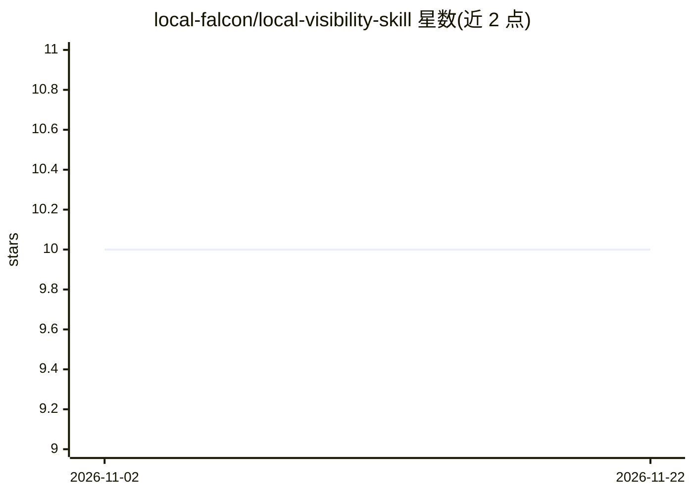

# local-falcon/local-visibility-skill

⭐ 10 · MIT · 推送 2026-02-02 · [GitHub](https://github.com/local-falcon/local-visibility-skill) · [官网](https://www.localfalcon.com) · 组织维护

**为 AI agent 提供本地 SEO 与 AI 可见性专家知识包**

以 SKILL.md 结构化知识文件形式分发的技能包，为 AI agent 注入三类知识：AI 可见性优化（如何在 ChatGPT、Gemini、AI Mode 等平台获得提及）、本地 SEO 实践（Google Business Profile 优化、地图包排名、评价策略）与 Local Falcon 平台解读（geo-grid 扫描、SoLV/SAIV 指标）。可搭配 @local-falcon/mcp 服务器读取实时数据；无 MCP 时仅输出教学内容。通过 npm 安装或手动复制到 Claude Code 技能目录使用，MIT 许可。

## 筛选速览

| 维度 | 判定 | 备注 |
|---|---|---|
| AI 角色 | `ai-knowledge` | 知识聚合/清单类 |
| 许可风险 | `permissive` | MIT |
| 部署形态 | `library` | 以包/库形式分发 |
| 模型依赖 | — | README 未给出锁定关系 |
| 硬件要求 | — | 无带数字的原话,不猜 |
| 安装摩擦 | `low` | 无编译、无系统依赖或容器化 |
| 成熟度 | — | 结构信号不足 |

## 能力要点

- SKILL.md 结构化知识文件，可直接纳入 agent 系统提示
- 区分 SoLV（地图排名）与 SAIV（AI 平台提及）两类指标
- 自动检测 MCP 可用性，实时分析与教学指导两种模式
- 覆盖 ChatGPT/Gemini/Grok/AI Overviews 的数据来源说明

## 适用场景

- 诊断我的业务为何在 ChatGPT 回答中不被提及
- 解读 geo-grid 扫描报告中 SoLV 与 SAIV 的变化
- 为多客户/多门店制定本地 SEO 优化方案

## 场景标签

 · 领域:数字营销/SEO

## 证据(README 行号)

> L13: This skill equips AI agents (Claude, ChatGPT, Cursor, and others) with expert-level knowledge about:
> L21: This skill provides structured knowledge that enables agents to give expert-level local SEO and AI visibility advic
> L42: Reference the `SKILL.md` file directly or include its contents in your agent's system prompt.

## 星数曲线

2026-11-02 10 → 2026-11-22 10（+0）

---
*卡片 v1 · prompt 1.4 · 生成 2026-11-19 · 置信度 high · 依据 README sha `83cc5738d850` · [字段定义](../../DATASET.md)*
