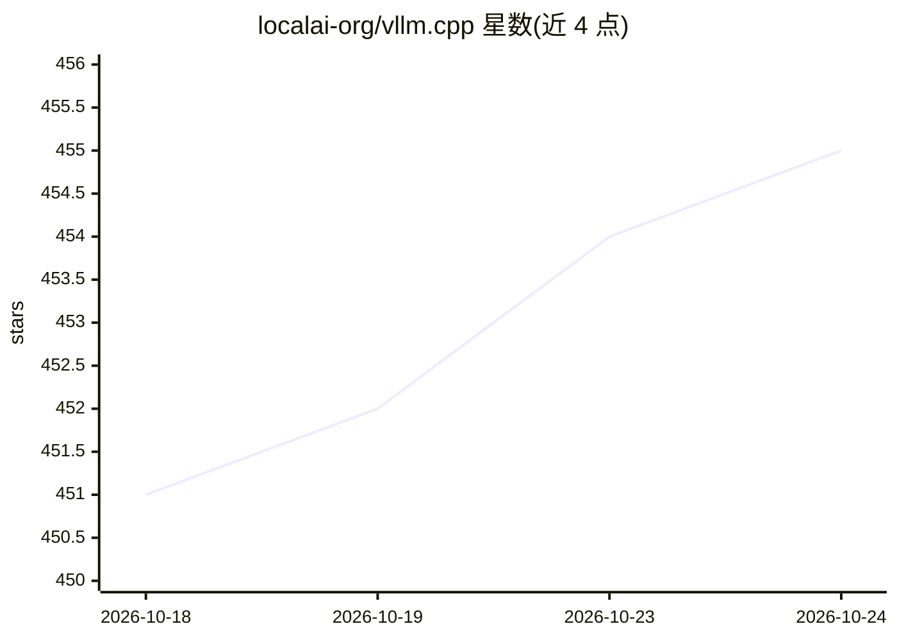

# localai-org/vllm.cpp

⭐ 455 · C++ · Apache-2.0 · 推送 2026-10-23 · [GitHub](https://github.com/localai-org/vllm.cpp) · 组织维护

**C++20 实现的 vLLM 式本地推理引擎，无 Python 依赖**

由 LocalAI 团队维护的社区项目（非 vLLM 官方），从零用 C++20 实现的推理引擎：吸收 vLLM 的 continuous batching、分页 KV、前缀缓存、投机解码，SGLang 的 RadixAttention 与缓存感知调度，以及 llama.cpp 的 GGUF/扁平 C ABI 部署方式。支持 CUDA/CPU/Metal/Vulkan 后端，提供 OpenAI 兼容的服务端与 66 MiB 二进制发布。项目自称处于重度开发期，CLI 与服务行为可能随提交变化，多项架构速度指标标注为待测。

## 筛选速览

| 维度 | 判定 | 备注 |
|---|---|---|
| AI 角色 | `ai-ecosystem` | LLM/agent 周边工具 |
| 许可风险 | `permissive` | Apache-2.0 |
| 部署形态 | `None` |  |
| 模型依赖 | — | README 未给出锁定关系 |
| 硬件要求 | `cpu-ok` | |
| 安装摩擦 | `high` | 编译与系统依赖俱全 |
| 成熟度 | `idea` | |

## 能力要点

- C++20 单库实现 continuous batching、分页 KV、RadixAttention、投机解码
- 支持 CUDA/CPU/Metal/Vulkan 多后端，GGUF 与 Safetensors 加载
- v0.0.2 提供 CPU/CUDA/Vulkan/Metal/MLX 八个预编译服务端归档
- 版本化 C ABI（include/vllm.h）供嵌入使用

## 适用场景

- 在自有硬件上以小体积二进制部署 LLM 推理服务
- 需要 vLLM 式吞吐特性但不想安装 Python 环境的场景
- 通过 dlopen 或 C ABI 将推理引擎嵌入应用

## 场景标签

`推理引擎` · 领域:训练与推理

## 证据(README 行号)

> L4:  Continuous batching, paged KV, CUDA / CPU / Metal / Vulkan. No Python anywhere.
> L104: vllm.cpp is a from-scratch C++20 inference engine chasing three things at once: be the
> L109: vLLM's serving core (continuous batching, block-paged KV,
> L145:  offload, Prometheus metrics, and the SGLang knobs, all in a library you can `dlopen`. Multimodal

## 星数曲线

2026-10-18 451 → 2026-10-24 455（+4）

---
*卡片 v1 · prompt 1.4 · 生成 2026-10-22 · 置信度 high · 依据 README sha `3e9b0ae204c4` · [字段定义](../../DATASET.md)*
