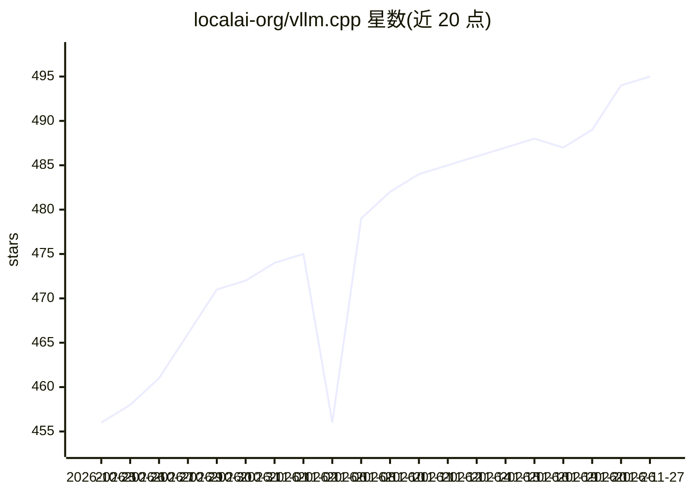

# localai-org/vllm.cpp

⭐ 495 · C++ · Apache-2.0 · 推送 2026-11-25 · [GitHub](https://github.com/localai-org/vllm.cpp) · 组织维护

**C++ 版 vLLM 风格 LLM 推理引擎，无 Python 依赖**

由 LocalAI 团队维护的从零实现的 C++20 通用 LLM 推理引擎，独立于 vLLM 官方项目。提供连续批处理、分页 KV 缓存、前缀缓存、投机解码等 vLLM 特性，并引入 RadixAttention、缓存感知调度等 SGLang 思路，支持 GGUF 与 Safetensors 权重、量化块上直接计算，通过 C ABI 库以 dlopen 方式嵌入，附 HTTP 服务器端点（补全、音频、视频、多模态输入）与 Prometheus 指标。提供 CPU/CUDA/Metal/Vulkan/MLX 后端与 GitHub Releases 预编译产物。项目处于活跃开发期，README 声明 CLI 与服务器行为可能随提交变化，多数架构的完整性与速度验证仍有缺口。

## 筛选速览

| 维度 | 判定 | 备注 |
|---|---|---|
| AI 角色 | `ai-ecosystem` | LLM/agent 周边工具 |
| 许可风险 | `permissive` | Apache-2.0 |
| 部署形态 | `None` |  |
| 模型依赖 | — | README 未给出锁定关系 |
| 硬件要求 | `cpu-ok` | |
| 安装摩擦 | `high` | 编译与系统依赖俱全 |
| 成熟度 | `idea` | |

## 能力要点

- C++20 实现，推理时无 Python 与 PyTorch，二进制 66 MiB
- C ABI（include/vllm.h）版本化，供应用嵌入
- 支持 GGUF/Safetensors、连续批处理、分页 KV、三种投机解码
- CPU/CUDA/Metal/Vulkan/MLX 多后端与结构化输出（GBNF）

## 适用场景

- 在无 GPU 机器上用 CPU 服务 LLM
- 以库形式将推理引擎嵌入 C/C++ 应用
- 需要 vLLM 风格连续批处理但部署环境装不下 Python 栈的场景

## 场景标签

`推理引擎` · 领域:训练与推理

## 证据(README 行号)

> L107: vllm.cpp is a from-scratch C++20 inference engine chasing three things at once: be the
> L112: vLLM's serving core (continuous batching, block-paged KV,
> L115: llama.cpp's deployment story (one library behind a flat C

## 星数曲线

2026-10-25 456 → 2026-11-27 495（+39）

---
*卡片 v1 · prompt 1.4 · 生成 2026-11-25 · 置信度 high · 依据 README sha `0bd191f7dbc4` · [字段定义](../../DATASET.md)*
