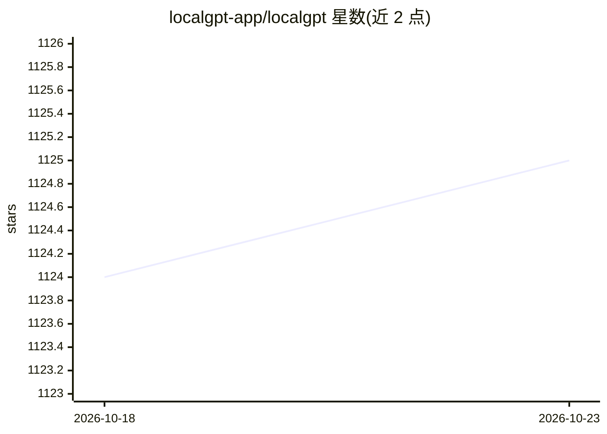

# localgpt-app/localgpt

⭐ 1,125 · Rust · Apache-2.0 · 推送 2026-10-21 · [GitHub](https://github.com/localgpt-app/localgpt) · [官网](https://localgpt.app/) · 组织维护

**本地运行的 AI 助手与 3D 世界生成工具**

Rust 单一二进制程序，含两个组件：localgpt 为本地优先的 AI 助手，提供持久记忆（Markdown 知识库 + SQLite FTS5/sqlite-vec 全文与语义搜索）、自主后台任务、CLI/Web UI/桌面/移动多界面、HTTP API，支持 LM Studio、Ollama、Anthropic、OpenAI 等多种 LLM 提供商；localgpt-gen 基于 Bevy 引擎用自然语言生成可探索 3D 世界（几何、材质、光照、音频、行为），可导出 glTF/GLB/HTML，支持无头批量生成、MCP Server 接入 Claude Desktop 等编辑器。安全方面采用内核级沙箱（Landlock/seccomp/Seatbelt）与提示注入防御。

## 筛选速览

| 维度 | 判定 | 备注 |
|---|---|---|
| AI 角色 | `ai-native` | 本体是模型或模型工具 |
| 许可风险 | `permissive` | Apache-2.0 |
| 部署形态 | `library` | 以包/库形式分发 |
| 模型依赖 | locked-api |  |
| 硬件要求 | — | 无带数字的原话,不猜 |
| 安装摩擦 | `low` | 无编译、无系统依赖或容器化 |
| 成熟度 | — | 结构信号不足 |

## 能力要点

- 自然语言生成 3D 世界，支持 glTF/GLB/HTML 导出与无头批量生成
- Markdown 知识库 + FTS5/sqlite-vec 双路记忆检索
- MCP Server 接入 Claude Desktop、Codex、VS Code 等编辑器
- 内核级沙箱与提示注入防御

## 适用场景

- 本地离线运行 AI 助手进行对话与知识管理
- 用自然语言生成可探索的 3D 场景并导出
- 把世界生成能力作为 MCP 工具接入桌面编辑器

## 场景标签

`AI 助手` `知识库管理` · 领域:对话与助手

## 证据(README 行号)

> L43: `localgpt-gen` is a standalone binary for AI-driven 3D world creation with the Bevy game engine.
> L103: `localgpt` is a local-first AI assistant with persistent memory, autonomous tasks, and multiple interfaces.

## 星数曲线

2026-10-18 1,124 → 2026-10-23 1,125（+1）

---
*卡片 v1 · prompt 1.4 · 生成 2026-10-21 · 置信度 high · 依据 README sha `80549653f03d` · [字段定义](../../DATASET.md)*
